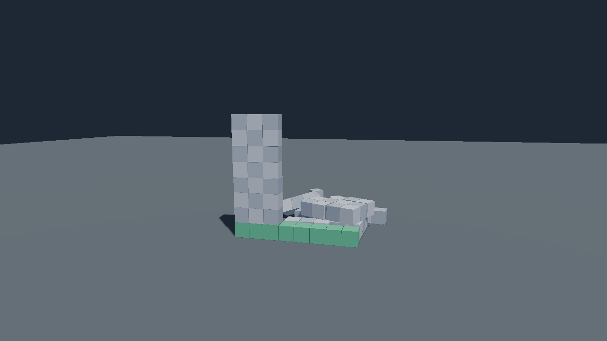
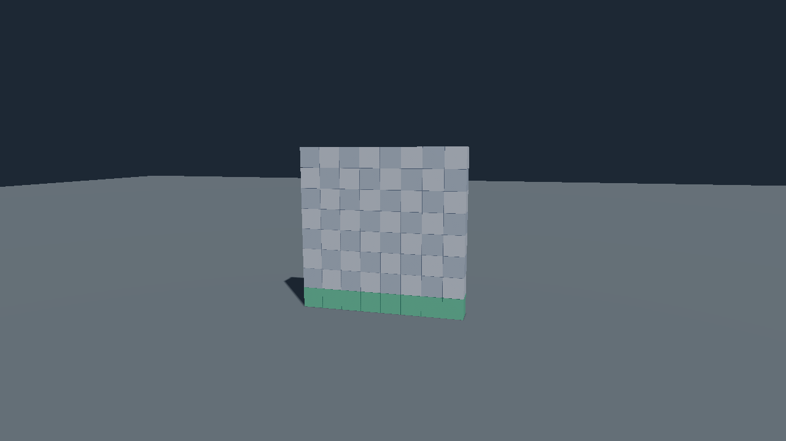

# Physics add-on

`c3d::physics` owns scene-bound rigid bodies, collision queries, joints, ragdolls,
fluid forces and pre-fractured breakables. Applications select `c3d_physics` and
its native dependencies; core does not import the package. Register physics on
the scene, create its world, and destroy the world before the scene/assets.

World-free prepared queries use `CollisionCache`, `CollisionShape` and borrowed
`CollisionShapeView` values in `c3d::physics`. A cache borrows one asset store and can share
cooked hull, mesh and height-field sources with worlds created with the optional fifth `cache` argument. Destroy
all borrowing worlds and prepared owners before the cache, then the store. Native length
units remain fixed through those lifetimes. Prepared shapes take a preparation scale: equal
magnitude for spheres and capsules, diagonal and mirrored for boxes, hulls and meshes, positive and
diagonal for height fields. Scaled hulls
are cooked once per geometry revision and exact scale, and identical requests share the entry. A
prepared mesh shares one unscaled cooked entry across scales. A prepared height field, from a texture
or from raw heights with optional holes, shares one entry per source and scale. Meshes and height fields
answer contacts, distance, translational casts, fixed-orientation sweeps and front-face rays against
convex shapes; surface pairs are `UNSUPPORTED`. The direct `c3d::physics::collide` API remains
available. See
[Collision queries](../../docs/collision_queries.md) for supported shapes, the scale domain,
surface semantics, height-field holes and index limits, capacity faults, query results and cache
ownership.

## Ragdoll recovery

`recover_ragdoll(skin_node, character, settings)` returns `RagdollFacing?` and
`recover_bones(skin_node, settings)` returns `void?`. Settings default to
`default_ragdoll_recovery_settings()`. Both select the currently SIMULATED bones
and validate entry before changing placement or recovery state. Call before
fresh animation, while the preceding final joint worlds remain intact.
Whole-body recovery returns physical facing and applies horizontal hips
placement; partial recovery leaves character placement unchanged.

Missing bodies or anatomical joints return `NO_BODY` or `NO_JOINT`. A mismatch
between mapped joints and native poses beyond the entry limits returns
`RECOVERY_POSE_MISMATCH`; invalid settings or inputs return `INVALID_ARGUMENT`.

Participants retain SIMULATED bone modes and DYNAMIC bodies. Each outer update
captures fresh animation and `min(weight, 1) * bone_weight`; each fixed step
tracks that target using current native feedback. Finite nonnegative authored
weights retain their existing range, including per-bone values above one.
Recovery applies a capped force at the centre of mass with gravity compensation
and a capped shortest-arc angular PD torque through current world inertia.

| Default setting | Value |
| --- | --- |
| Position and angular frequency | 4 Hz |
| Damping ratio | 1 |
| Per-body force and torque caps | 200 N; 20 N m |
| Entry position and angle limits | 0.01 m; 0.01 rad |
| Tracking diagnostic limits | 0.15 m; 0.3 rad |
| Completion mapped-joint limits | 0.015 m; 0.02 rad |
| Completion absolute COM and angular speed limits | 0.03 m/s; 0.05 rad/s |

Custom settings must be finite. Frequencies and caps must be positive; damping
and tolerances must be nonnegative. Nonfinite derived requests are rejected or
block the active recovery without applying them. Arbitrary settings and rigs
have no stability guarantee.

Recovery temporarily masks legacy spherical/revolute animation springs while
preserving their limits and authored values. `drive_strength` does not scale
the separate recovery actuator. Ending recovery restores current authored
spring enablement, frequency, damping and strength only to matching native
identities. `Ragdoll.recovery_status()` reports INACTIVE, TRACKING, BLOCKED,
READY or COMPLETING; participant count; mapped-joint target errors; absolute
body speeds; applied force/torque maxima; and captured-input or arithmetic
faults. BLOCKED is diagnostic: bodies remain physical.

Call the fallible `finish_ragdoll_recovery(skin_node)` after `update` and before
`update_ragdolls`. Completion requires this update's captured zero effective
weights and settled pose/velocity limits. `RECOVERY_NOT_READY` keeps recovery
active; `NO_RECOVERY` means no participants remain. Success changes authoring
to ANIMATED without a transform snap or native identity replacement. Native
poses remain published through that update; animation resumes on the next
physics update. Setting global weight to zero alone does not finish recovery.

Frame order is entry/re-entry, fresh animation and weights, `scene.update_world`,
`physics.update`, optional checked completion, `physics.update_ragdolls`,
`scene.update_world`, then cloth and debug consumers. Participating bone nodes
publish native current poses; mapped joints apply `joint_in_bone` to those same
poses. There is no interpolation or second visual blend. Updates without a
fixed step hold native poses, and repeated ragdoll publication is idempotent.
Unmapped children use captured local targets; nonparticipants keep ordinary
behavior. Later IK changes to participants end the pose-equality guarantee.

An explicit `set_bone_mode`, including the same enum value, cancels that bone's
active or completing recovery; `set_ragdoll_mode` cancels all participants.
Teleport cancels the addressed participant before moving it, retains ordinary
mode/velocity semantics and does not record completion. Body replacement,
removal and world teardown cancel affected recovery. Origin shifts translate
world targets. Stale native identities never receive restored drive settings.

The `ragdoll` example uses the shared humanoid and supine/prone motions in
`examples/ragdoll_getup.c3`, also consumed by `physics_test`. Its controls expose
obstruction, a movable neighbour and recovery status. `--acceptance <directory>`
writes bounded visual captures and numeric checks to an existing directory;
`--cpu-observation` runs a bounded CPU comparison. See
[Animation](../../docs/animation.md) for the animation/ragdoll contract.

| Prone get-up | Blocked recovery |
| --- | --- |
|  |  |
| The same dynamic capsules follow the get-up target. | An obstruction prevents completion without disabling simulation. |

The [focused contact example](../../docs/images/ragdoll_contact.png) shows recovery
forces pushing a movable neighbour while the bone remains simulated.

## Cloth

`c3d::physics::cloth` simulates a mesh over an owned geometry copy with optional physical-to-render
particle welding (`render_particles`), deformed normal domains and opt-in deformed tangent frames
(`tangent_frame`, `tangent_uv_set`), hard pins and weighted compliant XPBD attachments (`ClothAttachment`),
distance or signed dihedral bending (`ClothBendMode`, `bend_compliance`, `ClothRestAngle`), skinned
reference transport (`transport`), crowd cloth (`CrowdCloth`), authored cut paths and bounded tearing
(`ClothCutPath`, `ClothTearLimits`, `request_cut`, `cut_result`), areal particle mass
(`ClothDesc.density`), quadratic drag and lift from the node's `Wind` velocity
(`ClothDesc.drag_coefficient`, `lift_coefficient`; cloth ignores `Wind.drag` and `Wind.lift`),
an optional ground and one-way particle contacts with sphere, capsule, box,
hull, mesh, heightfield and compound colliders of the bodies listed in `ClothDesc.colliders`.
Contacts are discrete by default. Set `desc.collisions.continuous = true` to sweep
prediction, structural/pin corrections and contact responses against interpolated final
body poses, including shortest-path rotation. The default `max_ccd_iterations` is 64
per candidate path; exhausted progress reports `CONTACT_NONCONVERGENT`. An unsampled
cloth face can still pass through a small collider.
Set `desc.collisions.self_collision = true` for vertex-face and edge-edge contact within
one cloth at separation `2 * thickness - contact_tolerance`. Copied `ClothSeam` pairs
in `desc.seams` define vertex equivalence only for incidence and one-ring exclusions;
position coincidence does not weld topology. Pins have zero response weight, and a
fully pinned eligible conflict fails with `CONTACT_UNRESOLVED`.
Attach with `scene.add_cloth(&assets, node, desc)` and
call `physics.update_cloths()` once after `physics.update`, after final ragdoll/IK poses and
`scene.update_world()`, before rendering. See [Cloth](../../docs/cloth.md) for the contract,
faults, frame order and usage; the `cloth` example includes flag, cape, external-contact,
seamed-fold, fast-crossing, flag-field, cape-crowd and tessellation-comparison scenes
(`--scene flag|cape|both|contacts|fold|fast|field|crowd|densities|flag33`).
The manual Vulkan acceptance runs with
`c3c test cloth_acceptance --path addons/c3d_physics.c3l/test/gpu`.

Under the `C3D_PHYSICS_GPU` feature, a cloth prepared with `ClothDesc.execution = GPU` is solved by
`c3d::render::cloth_gpu` (`GpuCloths`, `create_gpu_cloths`, `update`, `read_positions`) as compute dispatches over
three shared buffers; it handles the subset of pins, distance edges, gravity, damping, the ground and one sphere,
and `prepare` refuses the rest with `UNSUPPORTED`. A small cloth steps in one dispatch, a large one in fused
passes. It writes the cloth's geometry through a geometry write. The `cloth_gpu` example runs it
(`--gpu --scene flag33`), `physics_gpu_test` checks the selection and `cloth_gpu_acceptance` runs it on a Vulkan device
(`c3c test cloth_gpu_acceptance --path addons/c3d_physics.c3l/test/gpu`). See [Cloth](../../docs/cloth.md#device-solver).

A cloth whose free particles stay under `ClothDesc.sleep_speed` for `sleep_steps` simulated steps
rests: it skips the solve and publication until a trigger wakes it (reference motion past
`sleep_speed * fixed_dt`, a moving listed collider near the cloth, a change of the `Wind` velocity or
maximum speed, a gravity change, a cut request or `wake()`). `Cloth.sleep()` and `CrowdCloth.sleep_slot(slot)` hold a cloth instead; a held
cloth ignores every trigger until `wake()` or `wake_slot(slot)`. Holds are meant for unseen cloth, because
a held skinned cloth stays frozen in its owner's frame. A wake carries a cloth on a rigid owner by the
owner's motion since its last publication, which keeps the drawn shape under rotation, and carries a
skinned cloth or crowd slot particle by particle by its reference displacement. `Cloth.activity()` reports the state and `PhysicsWorld.cloth_stats`
counts resting and held cloths. Publication marks only the changed vertex range of each stream, so
resting cloth leaves the geometry revision untouched. Rest and hold state is not serialized.

`physics.set_parallel({ .run = ..., .context = ... })` stages cloths and crowd slots on the application's
own worker threads, for example a `c3d::job` pool through a few-line adapter (the package imports no job
library; the `cloth` example's `--workers N` shows it). `update_cloths` collects the cloths that
simulate, stages them in parallel, each writing only its own `ClothState`, and commits asset-store marks and
scene-node writes serially in ECS order. The application must not mutate the scene or step the world
while `update_cloths` runs. Results are bit-identical to the serial path for any worker count; a zero
`ParallelFor` stages on the calling thread. See [Cloth](../../docs/cloth.md#parallel-staging).

`ClothDesc.collisions` sets contact tolerance, iteration count and prepared shape,
candidate and contact capacities. Native body/snapshot bindings are checked during updates;
compound leaves are resolved and counted there because preparation has no world argument.
Shapes use rigid physics' baked geometry and final scene body poses. Solved and published
contact histories are separate: zero-step publication never advances solved state.
`PhysicsWorld.teleport` resets referencing cloth observations after writing the body pose.
Use `cloth::reset_contact_history(Cloth*)` after direct scene-pose collider teleports;
reset does not move the fabric or change its velocity, and endpoint contacts still apply.
Pinned body/ground
overlaps are excluded from response and counted. A failed cloth retains committed simulation
and histories while other cloths continue; inspect `ClothState.contact_result` and
`PhysicsWorld.cloth_stats`. Moved-node publication is preserved only when its local float
re-expression meets the configured tolerance. Otherwise REEXPRESSION reports
`CONTACT_PRECISION_EXCEEDED`, keeps the old local bytes/revision, and the application-owned
transform may place that geometry elsewhere.

Cloth consumers require `fp-math=strict`, owner-thread (and staging-thread) round-to-nearest and gradual underflow.
The library checks supported runtime conditions without changing arithmetic modes; runtime
checks do not establish the consumer's compiler mode. Skinned `Mesh` + `SkinBinding` owners
move their rendered `Mesh` to an owned `ClothOutput` child on preparation (`cloth::prepare` with
`&physics`), and `CrowdCloth` (`scene.attach_crowd_cloth`, `cloth::prepare_crowd_cloth`) replaces
crowd part batches with per-slot `ClothOutput` children while supporting per-particle reference
`transport`. Use `scene.remove_cloth` and `scene.remove_crowd_cloth` (not `scene.remove_component`)
to remove cloth components so the source `Mesh` or crowd batch is restored and generated
`ClothOutput` children are deleted. Serialization stores `Cloth` in authoring version 8 (including `cuts`, `tears`, `sleep_speed` and
`sleep_steps`) and `CrowdCloth` in authoring version 3, projecting the retained source `Mesh` of prepared skinned
cloths and omitting generated `ClothOutput` children; runtime buffers, cut state, contact results and
histories are excluded. Older JSONC payloads default `sleep_speed` to 0 and `sleep_steps` to 30, `cuts` to empty and `tears` to `default_cloth_tear_limits()` (`opening_iterations = 32`, `max_requests = 0`); Version-1..5 JSONC defaults `transport` to empty; Version-1..4 JSONC
defaults the version-5 material, attachment and dihedral fields to empty/false/`DISTANCE`/`0`.
Version-1/2/3 JSONC defaults continuous contact off and the CCD limit to 64. Version-1/2 also
defaults self-contact off and seams empty; incompatible older binary layouts are rejected before
mutation.

## Replaced assets

A body keeps the collision snapshot it cooked when `replace_geometry` or `replace_texture` replaces its
source. Bodies created afterwards, and world rebuilds, cook the current revision. The geometry copy a cloth
owns is private to the cloth: do not replace or edit it.

## Height-field windows

A `TEXTURE` height field cooks the whole map into one native object, so an edit re-cooks every sample. A window
cooks part of it: `HeightField.window` is `{ x, z, count_x, count_z }` in cells, and a window reads
`count_x + 1` by `count_z + 1` samples starting at `x, z`, plus one sample past each side that has map beyond
it. All zero covers the whole map. A window needs a
`TEXTURE` source of 8-bit or `R16_UINT` samples, since only those convert into a fixed range; a window on a
`HEIGHTS` source, one with a zero count or one past the map faults `INVALID_ARGUMENT`, and an `RGBA32_FLOAT`
map faults `UNSUPPORTED`. A window's collider is placed by its node, like any height field: its origin is the
body origin.

A windowed field quantizes over the unscaled range 0 to 1, which is `0` to `scale.y` metres. Whole-map
fields keep the range of their own samples and cook as before. Equal quantization is what lets windows of
one map, and [tiles](../../docs/terrain.md#tile-sets) of one set at equal `height_scale`, meet exactly, and an
edit never re-quantizes another window. The snapshot key adds the window to the texture, revision, scale and
material indices, so each window takes one snapshot slot. The application sizes `PhysicsDesc.snapshot_capacity`
for the windows plus its other shapes: a window that finds no free slot fails to build with `CAPACITY_EXCEEDED`,
reported in `build_failures` at the update, and `add_height_field_windows` does not check. A re-cooked window leaves
its previous entry unheld, and a full table reclaims it.

```c3
physics::add_height_field_windows(
    scene:        &scene,
    assets:       &assets,
    node:         terrain_node.id,
    collider:     &collider,
    window_cells: 256,
)!;
// write texels in place, then:
assets.mark_texture_dirty(height_map);
physics::mark_height_field_windows_changed(&scene, terrain_node.id, { .x = x, .z = z, .columns = columns, .rows = rows })!;
world.update(dt); // re-cooks the marked windows only
```

- `add_height_field_windows` creates one child node per window under the node, at the window origin
  `(x * scale.x, 0, z * scale.z)`, each with a static `PhysicsBody` holding one windowed collider copied from the
  template, and a `HeightFieldWindows` component on the node that owns them. The template is a `HEIGHT_FIELD`
  collider over a `TEXTURE` source whose `window` is ignored; per-cell `material_indices` cover the whole map and
  are cut per window. Edge windows take the remaining cells. The node's world matrix is current when the call
  is made. The bodies build on the next update.
- Windows share the samples on their common edge and read one sample past it, so
  `mark_height_field_windows_changed` marks every window whose sample range `[x - 1, x + count + 1]` meets the
  rectangle, given in samples of the map, which are its texels. An edit on or beside a shared edge marks two
  windows and one on or beside a shared corner marks four. It returns how many it marked.
- A marked window is rebuilt synchronously by the next `PhysicsWorld.update`; an unmarked one is never rebuilt, so
  a body resting on it keeps its contact and its sleep. The rebuilt window has the one-step contact gap of any
  `mark_changed`. `PhysicsCounters.pending_bodies` counts the bodies marked and not yet built.
- To change `window_cells`, call `remove_height_field_windows` and `add_height_field_windows` again. Removing the
  node removes its window nodes with it, and the component's remove hook frees its list.
- A window reads the samples of its neighbours past each side that has map beyond it, so a body crosses a window
  seam as it crosses the interior of a whole field. A window with a neighbour takes its per-cell `material_indices`
  as its own cells plus one ring of map cells around them, repeated at the map border: `(count_x + 2) *
  (count_z + 2)` entries, against `count_x * count_z` for a window that covers the whole map.
  `add_height_field_windows` cuts both from the map-wide data.
- The edge of a map reads a neighbour where `HeightField.neighbours` names one. It holds four
  `HeightFieldNeighbour { texture, material_indices }` in `HeightFieldSide` order: `NEGATIVE_X`, `POSITIVE_X`,
  `NEGATIVE_Z`, `POSITIVE_Z`. The apron of a side holds the neighbour's second column or row in, since the first
  duplicates the shared edge, so a body crosses from one tile collider to the next as it crosses the interior of one
  field. A side without a neighbour repeats the border sample, and corners are never read. A neighbour needs the
  field's format and the length of the shared edge, and faults `INVALID_ARGUMENT` otherwise; `RGBA32_FLOAT` faults
  `UNSUPPORTED`, as for a window. A neighbour on a `HEIGHTS` source faults `INVALID_ARGUMENT`.
- A collider with a neighbour quantizes over the format's full range, like a window, so tiles with the same `scale`
  meet exactly. The cook rounds heights to 16 bits over that range, a height step of `scale.y / 65535`.
- A neighbour's `material_indices` are optional, one per neighbour cell, and copied with the body like the collider's
  own, so the caller's array need not outlive the call. A neighbour without them gives solid cells. A whole-map
  field's own indices stay one per cell and the cook rings them with the neighbours' cells.
  `add_height_field_windows` copies the template's neighbours, cuts their cells into each window's ring, and keeps on
  a window body only the maps of the sides where the map ends; a window beside another window carries none.
- Neighbour maps join the snapshot key and the revision sum behind the `SOURCE_UNAVAILABLE` retry. A live collider is
  still re-cooked only when marked: after an edit of a neighbour within two texels of the shared edge, mark this
  collider's facing edge. Adding or removing a neighbour changes the description, so rebuild the body or the windows.

With `C3D_PHYSICS_SERIAL`, `HeightFieldWindows` is a described owner whose payload is `{ window_cells, collider }`.
Export omits the window bodies and nodes, validating each node's `HeightFieldWindowOwner` marker, and loading
regenerates them through `add_height_field_windows`, so a restored terrain has its windows again with no
application call. `PhysicsBody` authoring is version 3 for `HeightField.neighbours` and `HeightFieldWindows` is
version 2; payloads of earlier versions still read, without neighbours and, before version 2, with a zero window,
in both formats.

## Breakables

A `Breakable` owns physical pieces, welds and optional static support anchors
below a root. Existing constructors derive welds from hull distances; an explicit
recipe supplies its complete graph. An edge breaks when an enabled strength
limit is reached. Its native joint is removed and a `BreakEvent` identifies the
edge and criterion. Breaking one edge need not disconnect a piece.

```c3
physics::register_physics(&scene)!;
PhysicsWorld world = physics::create_physics_world(
    allocator: mem,
    assets: &assets,
    scene: &scene,
    desc: physics::default_physics_desc(),
)!;
defer physics::destroy_physics_world(&world);

scene.update_world();
world.add_breakable(root, physics::default_breakable_desc())!;
```

The legacy `add_breakable` root must be a live non-scene-root node without a Mesh.
At least two Mesh nodes must occur below it. Each is an independent convex,
volume-spanning piece with positive unit scale and no skin/morph deformation.
Root and piece world matrices must be current, finite and rigid. Bake scale
into the asset. The initial ASSEMBLY form requires PARENT paths below its root;
the root itself may use either transform space.

For multiple render primitives or collision hulls per piece, use
`add_breakable_pieces(root, pieces, desc)`. Each `BreakablePieceDesc` holds a body
node's `Entity` and ordered piece-local `GeometryId` hulls. At least two distinct
live descendants are required; no piece may be an ancestor of another. Each
piece has at least one live hull, and may have any number of render children.
Material boundaries do not create physical pieces. The legacy convenience
still treats each Mesh descendant as one piece with one hull.

These entry points share graph construction, body creation, wake and rollback.
PIECES uses one dynamic body per piece with one HULL collider per supplied hull;
ASSEMBLY uses one root body with a collider-to-piece map covering every hull.
Removing a render-only child keeps its body. All hulls contribute to body mass
and center of mass. Hull geometry must remain available for world rebuild.

A glTF primitive becomes a Mesh node. Use explicit body parents to group several
primitives into one piece; collision hulls are independent geometry. The supplied
`examples/assets/fractured_wall.gltf` uses the legacy one-primitive form with
64 separate mesh placements and narrow seams.

Distance at or below `contact_distance` connects two pieces. The smallest
qualifying hull-pair distance selects the weld anchor; exact ties keep the first
pair in caller hull order (first piece's hulls, then second piece's hulls).
Each unordered piece pair has at most one weld, in caller piece-pair order.
Edge/corner contacts also count; the rule does not measure shared face area. Overlap is accepted. The
example uses 0.5 m cubes on a 0.508 m pitch: face gaps are below the default
0.01 m threshold, diagonal gaps are above it, producing 112 welds.

Deriving the graph tests every piece pair. `physics.set_parallel({ .run = ..., .context = ... })`
spreads those tests over the application's workers, the same `ParallelFor` that stages cloth.
Preparation, and the reset of a pending breakable, acquire the hulls and compute their bounds on the
calling thread. Each range then tests its own pairs against immutable hulls and bounds and appends
every connected pair, with its anchor, to a shared candidate list. The calling thread orders the
candidates by piece pair and builds the welds, so the graph is bit-identical for any worker count, and
a zero `ParallelFor` runs the same code on the calling thread. The list reserves 24 bytes of the
caller's temporary scope per piece pair and writes only the connected pairs; when the reservation
cannot be made, the call fails with `CAPACITY_EXCEEDED`. The application must not mutate the scene or
the world while preparation or a reset runs. Explicit recipes carry their own welds and derive none.

## Explicit recipes and strengths

`BreakableRecipeDesc` contains ordered `BreakablePieceView` values, internal
`BreakableWeldDesc` values, `BreakableAnchorDesc` values, physical settings,
default strength and an evaluation mode. Begin with
`default_breakable_recipe_desc()`. Each piece supplies its Entity, ordered hull
IDs and root-relative `rest_frame`. The weld and anchor lists are authoritative;
an empty list creates no edges. The library copies all inputs on attachment.

An internal weld names two distinct piece indices, a rigid frame in each piece,
and a unit `moment_axis` in frame A. For an anchor, frame A is local to the piece
body's origin and frame B to the target body's origin, rather than their centres
of mass. Its complete target Entity must have a live ordinary STATIC body when
prepared. Entity values are scoped to the receiving Scene: pass IDs obtained from
that Scene. IDs contain no Scene token, so an identical value obtained elsewhere
cannot be distinguished by origin. Native-world membership is checked when binding.
The application retains the target and its independent bodies/joints; the
Breakable owns only its anchor weld. Place a support outside the Breakable
subtree, such as a sibling under a shared scene parent. Existing restrictions
on independent body, joint, ragdoll and nested Breakable roles still apply.

`BreakableStrength` has three finite nonnegative limits:

| Field | Quantity | Unit |
| --- | --- | --- |
| `force` | Reaction-force magnitude | N |
| `twist` | Absolute torque component along the world-space moment axis | N·m |
| `bending` | Magnitude of the remaining torque | N·m |

Zero enables a criterion at zero load; `float::max` disables it.
`default_breakable_strength()` sets 2,000 N and disables both moment limits.
A piece's `has_strength` selects its copied value; otherwise it inherits the
recipe default. An anchor's `has_target_strength` does the same for its target.
Take the componentwise minimum of the two endpoints, then replace all three
limits when `has_strength_override` is set. An override may strengthen or disable
a criterion. Contact `SurfaceMaterialDesc` values remain independent.

`NATIVE_FORCE` is the default and preserves native force-threshold behavior.
Enabled moment limits require `SAMPLED_REACTION`. That mode reads each live
weld's reaction immediately after every fixed step, using the current native
frame A for its moment axis. It compares each magnitude with `>=` and selects
force, then twist, then bending if several limits match. The native getters
represent stored post-step impulses divided by the native substep duration.
They are neither substep peaks nor outer-frame averages; a transient earlier
in the step can be missed. Zero fixed steps produce no new sample.

## Fracture generation

Fracture generation is maintained in the standalone
[c3d_fracture.c3l](https://github.com/fesoliveira014/c3d_fracture.c3l) project under
the `fracture` namespace, with c3d as a dependency. This package accepts
authored hulls through `add_breakable_pieces` and retains captured recipes,
preparation, welds and break events. See [Fracture generation](../../docs/fracture.md)
for the project boundary.

## Pending fracture preparation

`scene.attach_breakable_pieces(&assets, root, pieces, desc)` captures an automatic
recipe. `scene.attach_breakable_recipe(&assets, root, recipe)` copies an explicit
graph, rest frames, strengths and anchors. Both work without a PhysicsWorld,
cooked hulls or native objects. Caller arrays may be released afterward;
attachment leaves node poses and independent authoring unchanged.
`Breakable.is_prepared()` is false until runtime preparation succeeds.

`world.prepare_breakable(root)` cooks the retained hulls and creates the requested
initial representation. It derives an automatic graph or preserves the explicit
one, and checks required static targets before native construction.
It publishes a new state only after all preparation succeeds. The old state and
its borrowed arrays are invalidated on success. A prepared call is unchanged.
Failure leaves the pending recipe, nodes and earlier prepared owners unchanged;
staged native objects and hull holds are released. Correct a failed asset or
capacity condition and retry preparation.

`world.prepare_breakable_subtree(root)` attempts every owner under the selected
root and returns the first failure after completing the other owners. Omitting
`root` selects the whole scene. Normal physics updates leave unprepared owners
pending, including after world replacement. BodyStatus.PENDING still describes
native rebinding for owners that already completed preparation; it is separate
from `is_prepared()`.

The captured piece identity must still be live at preparation. Deletion and slot
reuse do not replace it. Captured hull order and rest frames remain unchanged.
Automatic preparation derives candidate welds while temporarily holding cooked
hulls. Both recipe kinds check current relative piece poses before staging
bodies or native welds.
Position tolerance is the larger of 0.0001 metres and one millionth of the largest
absolute coordinate among the pair's current world positions and captured rest
positions. This covers accumulated float transform rounding at large world
coordinates. Angle tolerance is 0.0001 radians. A rigid motion of the whole piece
set is accepted. A displaced connected piece returns
`INVALID_ARGUMENT` and remains pending. Restoring its placement permits retry.
Bodies begin at their current piece-node poses; the assembly retains the matching
current collision frames separately from the immutable captured recipe.

`breakable.preparation_mismatch()` returns a read-only borrowed
`BreakableMismatch*`, or null when no mismatch exists. Its `piece_a` and `piece_b`
indices refer to the copied piece order. The borrow expires at the next
preparation or removal. Details clear before each preparation attempt and after
success. Callers identify the root from the node passed to preparation (or the
entity owning the component) and can report its path alongside the pair.

Attachment rejects dead piece/hull identities with `INVALID_ID`; empty hull
lists, duplicate/non-descendant pieces and fewer than two pieces with
`INVALID_ARGUMENT`; incompatible ownership with `BREAKABLE_EXISTS` or
`BODY_EXISTS`; and failed recipe allocation with `CAPACITY_EXCEEDED`.
Invalid captured piece rest frames return `UNSUPPORTED` or `INVALID_ARGUMENT`.
Malformed explicit weld or anchor frames return `INVALID_ARGUMENT`.
Every attachment failure adds nothing. Pending owners show their ordinary
authored piece nodes but have no
native bodies or welds. `PhysicsWorld.prepare_breakable_subtree` requires a physics
world, live piece/hull sources and piece poses matching the recipe relations.
The eager `add_breakable`, `add_breakable_pieces` and `add_breakable_recipe`
constructors attach and prepare in one call, removing their attempted pending
authoring on failure. The existing automatic constructors retain their
validation differences: the legacy mesh-tree constructor supports nested
mesh pieces, while the explicit-piece constructor rejects ancestor-related
pieces. Captured views support recipes produced by either constructor.

## Forms, ownership and faults

`default_breakable_desc()` selects ASSEMBLY: one enabled kinematic root body
with every piece hull. Pieces remain parent-relative and follow the root. A
qualifying dynamic-body hit changes it to PIECES: one dynamic body per
surviving piece, with its node committed to WORLD. Setting `sleep_until_hit`
false creates PIECES directly. `wake_breakable(root)` performs the transition
explicitly; a live PIECES call is a no-op.

`break_force` is finite nonnegative newtons, `contact_distance` finite
nonnegative meters, and density finite positive kg/m³. Surface coefficients
are finite/nonnegative and tangent velocity finite. The descriptor, geometry
identities and fracture layout are captured. Recreate to change them. Read
state through `scene.get(root, Breakable).state`; retain the root ID and
reacquire the component after structural changes. The state and its arrays are
library-owned. The component is 8 bytes on x64; its state/arrays are allocated
only for real breakables in one scene-allocator block.

`state.piece_view(index)` exposes the captured Entity, ordered hull IDs,
root-relative rest frame and optional strength. `state.weld_view(index)` exposes
the two piece indices, local frames, moment axis, effective strength and override.
`state.anchor_count()` and `state.anchor_view(index)` expose copied anchor
authoring and effective strength. These views contain no native IDs or damage.
Indices stay stable for the captured runtime even after removal; callers check
Entity liveness. Reacquire state and borrowed hull arrays after preparation or
removal. Re-authoring the same automatic inputs derives the same ordered graph.

Creation rejects overlapping breakables, existing bodies or conflicting
joint/ragdoll roles in the subtree, invalid geometry and unsupported transforms.
`BREAKABLE_EXISTS`, `BODY_EXISTS`, `INVALID_ARGUMENT`, `INVALID_ID` and
`UNSUPPORTED` identify those cases. Missing uncached hull source reports
`SOURCE_UNAVAILABLE`; snapshot exhaustion reports `CAPACITY_EXCEEDED`; native
constructor/hull faults propagate. No component-store capacity fault is invented.

Creation and wake are transactional for surviving pieces. Explicit wake first
prunes externally removed pieces; that cleanup remains even if transition
construction fails. Failed wake retains the remaining assembly and
visitor velocity, releases staged objects/holds and permits another request.
Automatic failures enter `build_failures()`. A failed or pending representation
cannot be explicitly awakened and reports `NO_BODY` until ready. On a new
world, pending piece bodies remain disabled until all surviving unbroken
edges can bind; terminal binding failure is recorded as FAILED. Source failures
follow the existing revision retry policy. Other failures require an explicit
reset with ready inputs or recreation.

Remove pieces through normal scene removal. The next physics update prunes
incident edges without a break report and removes their assembly collision
shapes and authored collider entries. World replacement cannot resurrect them.
Removing all pieces leaves an empty valid component. Use
`world.remove_breakable(root)` to remove owned bodies/welds while keeping nodes
and meshes; WORLD piece transforms stay WORLD. Removing only the raw component
releases graph state/welds but leaves authored bodies for application takeover.
Removing the root subtree releases everything through normal hooks.

## Static anchors and reset

Anchors constrain dynamic PIECES after wake. ASSEMBLY remains one kinematic
root body and has no live anchor welds. Wake stages all piece bodies and their
internal/anchor welds before replacing the assembly.

An unbroken anchor rebinds when the same target Entity acquires a replacement
STATIC body. An unavailable or non-static target makes it inactive and reports
a binding failure; this is not a strength break. It can bind again when the
same target becomes usable. Deleting the target permanently prunes its captured
anchor, even if the Entity slot is reused. Broken edges stay broken through
body/world replacement until an explicit reset repairs them.

`world.reset_breakable(root, form, root_pose)` selects ASSEMBLY or PIECES.
The optional `maths::Transform* root_pose` is a rigid world-space pose; null uses
the root's current pose. For example, to repair released pieces at the current
root placement:

```c3
world.reset_breakable(root, PIECES)!;
```

Reset returns surviving pieces to their captured rest frames, repairs surviving
internal edges and non-pruned anchors, and clears velocities and interpolation
history. It does not recreate
deleted nodes, regenerate geometry, or move support bodies. Existing collision
snapshot and source-revision rules still apply.
Zero survivors remain valid with no native body; one survivor creates the
selected form's single body without internal welds.

Reset also supports pending or failed captured recipes once required inputs are
ready. The requested placement must agree with every surviving fixed anchor,
including broken anchors that reset would repair. Disagreement returns
`INVALID_ARGUMENT`. Replaced foreign bodies or foreign joints attached to an
owned body are rejected; unrelated joints on retained support bodies are allowed.

Call reset on the owner thread outside native stepping and event-stream
consumption. A returned validation, capacity or construction fault preserves the
live representation, poses, velocities, handles and damage state while releasing
staged objects. Cleanup of already-deleted Entities is retained. A prepared reset
retains captured authoring storage and indices but replaces owned native handles;
reacquire body/joint handles afterward. Preparing a pending recipe still
invalidates its old authoring borrows. The backend's process-fatal native
allocation failure cannot be rolled back.

## Update and event order

```c3
scene.update_world();
world.update(dt);
foreach (event : world.breaks()) {
    handle_break(event.root, event.piece_a, event.piece_b, event.point);
}
scene.flush_removals();
scene.update_world();
```

`handle_break` is application code in this function-body example. Consume node
borrows before removals. Reports reset once per update and accumulate across
its fixed steps. Capacity overflow increments the shared `dropped_events`
counter; a full or zero-capacity report buffer still allows wake and fracture.
The point is the authored weld anchor through the current physics pose,
not a guaranteed impact point or seam centre. A single edge reports once per
break/reset cycle. `edge_kind` and `edge_index` identify the captured internal
weld or anchor; `endpoint_a`/`endpoint_b` retain Entity identities, with endpoint B
the borrowed target for an anchor. Node pointers remain frame borrows.

`phase` distinguishes `NATIVE_THRESHOLD` from `POST_FIXED_STEP`.
`loads_available` is false for native-threshold reports because the actual trigger
load is unavailable. Sampled reports retain all three `loads` and effective
`limits`, even when only one `criterion` triggers. Within each Breakable/fixed
step, sampled reports follow internal-weld index order, then anchor index order.
Native-force reports retain native event order.

Intact wake uses `mass * approach_speed >= break_force * fixed_dt`, plus the
world's hit-speed threshold. This is a wake heuristic, separate from the selected
weld evaluation mode. Native event streams are consumed before
structural mutation, and only one qualifying hit is replayed per assembly/step.
Automatic wake uses the native assembly pose; manual wake uses its current
authored root pose. Fragments inherit assembly linear/angular motion. Staged
bodies are enabled before their captured velocities are restored, since the
native backend drops velocity writes on disabled bodies.

The visitor's relative normal point speed is restored after successful wake;
tangential and angular motion remain. This approximates first contact one step
later. It is not an exact collision-history reconstruction and imposes no
universal fracture latency. An unanchored remainder may tip under a strong impact.
Native record/replay includes the body/joint mutations, but does not recreate scene
components or re-dispatch BreakEvent values.

## Update cost

The world keeps a list of its dynamic and kinematic bodies. The previous-pose copy and kinematic
target of each fixed step and the pose write-back visit that list, so static bodies add no work
there. The scan for bodies whose `PhysicsBody` was removed runs only after such a removal.
A breakable weld or anchor event finds its edge through a slot table keyed by the native joint
index and takes it only while the edge still holds that joint. The pass over authored
`PhysicsBody` components that finds pending builds still visits every authored body each update.

`physics_components` times `physics.update` without a window or renderer:

```powershell
c3c build physics_components --path addons/c3d_physics.c3l -O3
addons/c3d_physics.c3l/build/physics_components.exe --stress --benchmark 600
```

It prints the mean and 95th-percentile milliseconds over the given number of fixed steps, after
a settling period, with the body counts by kind. `--stress` adds about twenty thousand static bodies.

## Debug draw cost

`PhysicsWorld.debug_draw` stops generating collider lines once the sink is full and adds the number
of lines it skipped to `DebugDraw.dropped`, so the drawn lines and the dropped count are those of a
draw that generated everything. Past that point each collider costs only a count of its lines.

With `physics.set_parallel(...)` installed and more than 256 bodies, collider lines are generated on
the application's workers when they all fit in the sink's remaining capacity. Each range
writes its own slice of the sink, so the result is bit-identical to the serial draw. A sink that
cannot hold them draws serially. The ranges read box3d body and shape state; do not
step or edit the world while `debug_draw` runs.

```powershell
addons/c3d_physics.c3l/build/physics_components.exe --stress --benchmark 300 --debug-draw --workers 8
```

`--debug-draw` times `debug_draw` of the colliders into a sink that holds every line and into a
default sink, and prints a checksum of the sink's vertices that is equal for every `--workers` value at the same frame count.
`--workers n` runs `c3d_job` workers; 0, the default, draws on the calling thread.

## Rebasing the origin

After `Scene.shift_origin(offset)` and `scene.update_world()`, call
`physics.shift_origin(&scene, offset)` with the same offset (`offset.y == 0`). It
subtracts the offset from every body's pose through `set_transform`, including static
bodies, then rebuilds the static tree once. Velocities, sleep state, joints, welds and
contacts are kept, so a resting stack stays asleep. Cloth positions, pin anchors and
targets, collision shapes and the sampled body poses move with it; nothing allocates.
Call it between `end_frame` and the next `physics.update`. A recording captures the
shift as `set_transform` calls of every body, and replay reproduces it. The
`FluidSurfaceFn` or `FluidSampleFn` of buoyancy belongs to the application and must follow the shift.
See `docs/large_world.md` for the full order.

## Example and checks

```powershell
python scripts/build.py --example breakable
addons/c3d_physics.c3l/build/breakable.exe --pieces
addons/c3d_physics.c3l/build/breakable.exe --model addons/c3d_physics.c3l/examples/assets/fractured_wall.gltf
addons/c3d_physics.c3l/build/breakable.exe --frames=120 --acceptance --capture=fracture.rgba
addons/c3d_physics.c3l/build/breakable.exe --anchors --sampled --acceptance --frames=480 --reset-at=420
c3c build breakable --path addons/c3d_physics.c3l -O3
addons/c3d_physics.c3l/build/breakable.exe --benchmark
addons/c3d_physics.c3l/build/breakable.exe --benchmark --workers 4
```

Left click launches a box; right drag orbits and the wheel zooms. The panel
selects bottom-row anchors, native or sampled evaluation, force/twist/bending
limits and the initial form. Rebuild applies those settings and clears
projectiles. The two reset buttons restore the captured recipe as ASSEMBLY or
PIECES; they do not adopt edited controls until Rebuild is used. The panel shows
the last break criterion and distinguishes sampled loads from native-threshold
reports, whose triggering load is unavailable.

`--anchors` adds bottom-row support anchors; `--sampled` selects sampled reaction
strengths. `--reset-at=420` resets after 420 frames to the selected initial form.
The demonstration uses a 40,000 N force threshold and a dense 1,000 kg projectile
at 15 m/s, independently of the library's 2,000 N default. `--walls 32` shows the
multi-wall case.
Capture files are 1280×720 RGBA8 scene pixels. The GPU example always enables
Vulkan validation. WSL is restricted to builds and CPU tests.

The CPU benchmark reports authoring/update costs and native body/joint/awake
counts. Timed updates exclude geometry/node creation and world-transform
publication. Maximum strength retains the complete graph during idle runs;
PIECES does not imply that its native bodies are asleep. Timing results and
manual acceptance records belong to the corresponding change evidence.

`--workers n` runs graph derivation on a `c3d_job` pool of n workers; 0, the default, uses the calling
thread. The example's project selects `c3d_job`; the package does not. The benchmark's `authoring`
lines give the time to author one 8×8 and one 32×32 piece wall, and a checksum of the resulting graph,
which is equal for every worker count.


The anchored example before and after restoring its captured rest recipe:





Run `python scripts/build.py --test` for the full CPU matrix, or
`c3c test physics_test --path addons/c3d_physics.c3l` for the package. The breakable
cases cover ownership, rollback, native thresholds, removed assembly shapes,
world replacement, overflow, publication and motion inheritance.
