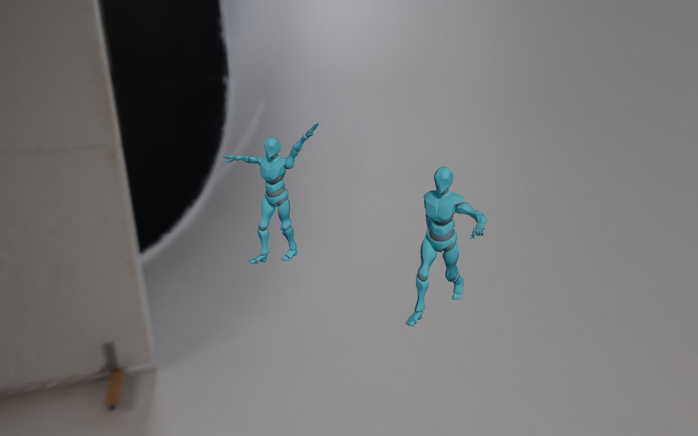
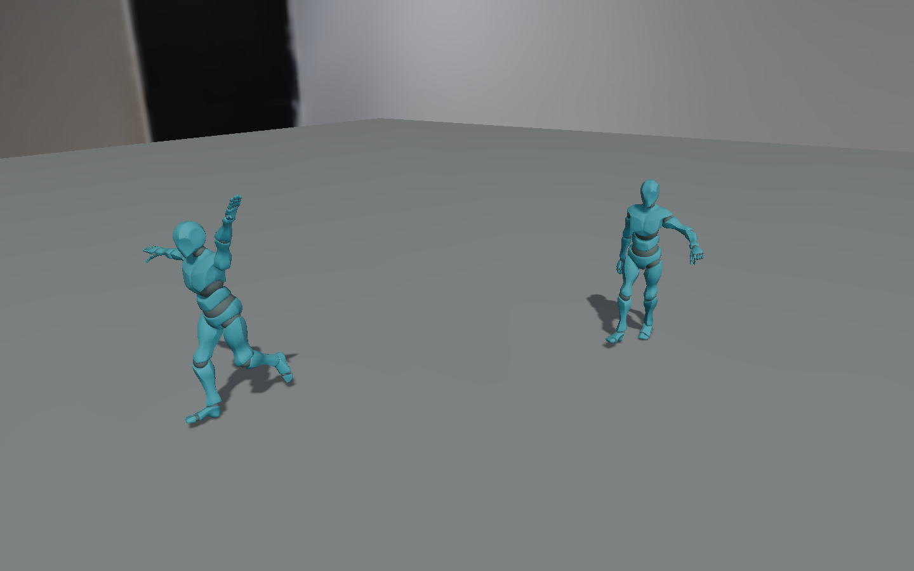

# Animation

`c3d::anim` plays the clips a model import stored onto a model instance. It samples clips, blends them in layers,
extracts root motion, delivers clip events, drives blend spaces and corrects pose jumps with inertial transitions. The
application owns the update sequence; nothing in the scene graph or the renderer advances an animation. The module needs
no feature flag and creates no GPU object.

| Page | Contents |
| --- | --- |
| This guide | Playing, blending, masking, root motion, events, blend spaces and inertial transitions on an `Animator`. |
| [Reference](animation_reference.md) | Types, constants, faults, blend formulas and the clip event import schema. |
| [Inverse kinematics](animation_ik.md) | Two-bone limbs, feet and look-at, with retained foot contacts. |
| [Retargeting](animation_retargeting.md) | Rebinding clips onto another model, rest-pose correction and calibrated profiles. |
| [Performance](animation_performance.md) | Crowd playback on worker threads, shared samples, compressed clips and memory costs. |
| [Deformation](animation_deformation.md) | What the renderer draws for skinned and morphed meshes, and compute skinning. |

## Quick start

Load a model once, instantiate it, add an `Animator` to the instance root and play a clip.

```c3
import c3d;
import c3d::anim;
import c3d::asset::gltf;
import c3d::model;
import c3d::scene;

ModelId model = gltf::load_model(&assets, "models/fox.glb")!;
Node* fox = model::instantiate(&assets, &scene, model)!;
ClipId[] clips = scene.get(fox, ModelInstance).clips;

Animator* animator = anim::add_animator(&scene, fox);
animator.play(&assets, clips[0])!;

// Every frame:
anim::update(&assets, &scene, dt);
scene.update_world();
renderer.render(&scene, camera_node)!;
```

`anim::update` advances every action of every `Animator`, samples its clip and writes the local transforms of the
instance nodes and the morph weights of the instance meshes. `Scene.update_world` turns the locals into world matrices.
The renderer reads the pose it finds. Crowds advance through `anim::crowd_update` instead
([Performance](animation_performance.md#crowd-playback-on-workers)).

## Concepts

### Update sequence

Physics and IK run between the animation update and the final `Scene.update_world`:

1. `anim::update` (and `anim::crowd_update` for crowds).
2. `Scene.update_world`.
3. Physics, including ragdoll publication; see [Physics add-on](../addons/c3d_physics.c3l/README.md#ragdoll-recovery).
4. IK solves ([Inverse kinematics](animation_ik.md#solve-order)).
5. `Scene.update_world`, then the renderer.

Animation owns the final pose until a later writer changes it. Root motion and events are outputs for the application to
consume; no scheduler consumes them.

### Animator and actions

An `Animator` is a component on the synthetic root that `model::instantiate` returns. Add it with `anim::add_animator`,
once per root. It owns a fixed pool of 16 actions, addressed by `AnimationActionId`. Its action pool, event buffer, model-sized
mask rows and two blend-space slots live in per-animator blocks allocated by `add_animator`. The component itself holds
pointers, counts and the last root-motion delta, and the component store reserves one `Animator` per scene node slot.

```c3
Node* left = model::instantiate(&assets, &scene, model)!;
Node* right = model::instantiate(&assets, &scene, model)!;
ClipId[] clips = scene.get(left, ModelInstance).clips;

Animator* left_animator = anim::add_animator(&scene, left);
left_animator.play(&assets, clips[0])!;

Animator* right_animator = anim::add_animator(&scene, right);
AnimationActionId run = right_animator.play(&assets, clips[1])!;
right_animator.action(run).speed = 1.5f;
```

`play` validates the clip's model-local targets against the instance and returns the action ID at time zero, weight one,
looping. Its faults are listed in [Faults](animation_reference.md#faults).

| Call | Effect |
| --- | --- |
| `stop(action)` | Remove the action. |
| `stop(action, seconds)` | Fade the action out, then remove it. |
| `cross_fade(from, to, seconds)` | Fade `from` out while `to` fades to full weight. |
| `play(&assets, clip, { .fade_in = seconds })` | Start at weight zero and fade in. |

`stop` and `cross_fade` validate before changing either action. An ID whose fade-out already ended is stale.

IDs survive other plays and removals and are meaningful only with the animator that issued them. A removed generation
never resolves to its replacement while that animator lives. Destroying and recreating the animator starts a new owner:
discard its old IDs.

- `try_action(id)` faults `INVALID_ID`; `action(id)` borrows a known-live action.
- Retain IDs, not pointers. Reacquire action pointers after any structural action operation, and `Animator` pointers
  after component-store changes.
- Iterate `order[:action_count]` for the live IDs in play order.

`Action.time`, `speed`, `weight`, `loop` and `playing` are runtime controls. Numeric values must be finite and `weight`
nonnegative. `playing` gates only the clock, so paused actions still pose. Everything captured at play (clip, layer,
additive mode, masks, reference samples, root-motion mode and extraction) is fixed: recreate the action to change it.
The clip must stay live, and its targets, tracks, paths and strides must stay unchanged while an action plays it;
`replace_clip_owned` enforces this. Blend-space members are read-only; their space controls playback.

### Pose ownership

While an animator exists it owns the pose of its instance: every update writes the local transform of every present
instance node and the morph weights of every present instance mesh. The synthetic root is not an instance node and stays
under application control, so moving or spinning an instance as a whole is unaffected. Removing the root removes the
animator through the component hook and frees its arrays; the shared clips stay in the store.

### Removed instance nodes

`ModelInstance.present_node(template_index)` borrows the original node or returns null after its removal. Each pointer
has a captured `Entity` identity, so slot reuse never binds a template index to a replacement node. Use the accessor
before reading a template node. `Animator.nodes` is only a borrowed alias of the pointer table.

- The captured identities, node table, authored baselines and mesh indices keep their original extents. They are
  library-owned and must not be rebound.
- Animation skips tracks for absent nodes and morph tracks for removed `Mesh` components. A missing root-motion target
  contributes no motion. Actions keep their clips, modes, masks and playback state, and surviving tracks continue.
- Reparenting a live template node outside the instance subtree keeps its identity and animation membership.
- `SkinBinding.joints` is a borrowed array of live joint nodes. Every joint must stay live while its binding is used for
  skinning, bounds or joint search, so remove dependent bindings before their joints.

### Replacing clips and models

A clip replacement keeps its track layout ([Replacing geometry, skeletons and clips](assets.md#replacing-geometry-skeletons-and-clips)),
so playback re-seeks on the next update. Additive reference samples and root-motion state stay as sampled from the old
clip until the action is played again. A model replacement may grow the template's clip list. Crowd actions accept any
live clip compatible with their captured node and morph layout, including clips outside that list.

## Play and blend

### Layers and masks

`PlayDesc.layer` selects one of four layers, folded in ascending index. Layer 0 starts from the authored baseline; upper
layers start from the result below. Play order does not change layer order. A channel with no contribution on a layer
keeps the lower result.

Masks address model-local nodes, including morph-bearing mesh nodes. The caller owns a `JointMask`; `play` copies it into
one of the animator's preallocated mask rows, so destroying or editing the input afterwards changes no action. A null
mask selects all nodes; an all-false mask selects none.

```c3
String[1] names = { "mixamorig:Spine1" };
JointMask upper = anim::create_joint_mask(mem, &assets.model(model).data, names[..])!;
defer anim::destroy_joint_mask(&upper);

AnimationActionId overlay = animator.play(&assets, overlay_clip, {
    .fade_in = 0.2f,
    .layer = 1,
    .mask = &upper,
})!;
animator.action(overlay).weight = 0.5f;
```

Use the model's actual joint names. Every exact match is selected, with descendants by default; pass
`include_descendants: false` for only the matching nodes. A missing name faults `NOT_FOUND` before allocation. `play`
rejects a mask whose node count differs from the instance. Reuse a mask only with instances of the model whose indices
it describes.



### Weighted and feathered masks

`PlayDesc.weighted_mask` borrows a caller-owned `WeightedJointMask` during `play` instead of a boolean mask. Supplying
both mask types faults `INVALID_ARGUMENT`.

- `create_weighted_joint_mask(allocator, assets, model, names, weights)` selects exact names with finite weights in
  `[0,1]`. Every matching node participates and repeated entries combine by maximum. An empty list selects no nodes.
- `create_feathered_joint_mask(allocator, assets, model, names, weights, depths)` also takes one depth per named seed. At
  descendant distance `d`, seed weight `w` contributes `w * min(1, (d + 1) / (depth + 1))`. Weight 0.8 and depth 3
  give 0.2, 0.4, 0.6 and 0.8 at distances 0 through 3, then 0.8. Depth zero selects the whole subtree at `w`.
  Overlapping seeds combine by maximum.

```c3
String[1] names = { "DEF-spine.001" };
float[1] weights = { 0.8f };
uint[1] depths = { 3 };
WeightedJointMask upper = anim::create_feathered_joint_mask(
    allocator: mem,
    assets: &assets,
    model: model,
    names: names[..],
    weights: weights[..],
    depths: depths[..],
)!;
defer anim::destroy_weighted_joint_mask(&upper);

animator.play(&assets, overlay_clip, { .layer = 1, .weighted_mask = &upper })!;
```

The effective contribution is `action.weight * mask.nodes[node]` for every translation, rotation, scale and morph channel,
including root motion. Masked and zero-weight advancing actions still emit events. Each masked action owns
`node_count * float::size` extra bytes until removal.

### Regular blending

Each channel (translation, rotation, scale and each morph weight array) blends separately against the lower layer's
value, which is the authored baseline on layer zero. Actions that animate a channel contribute by weight; the unspent
part of weight one keeps the lower value. A rotation-only clip leaves translation and scale at their authored values.
Two actions at weight 1 average. The formula is in [Blend formulas](animation_reference.md#blend-formulas).

### Additive actions

Set `PlayDesc.additive = true`. `play` captures each track's sample at time zero once, including the value rather than
tangent fields of cubic keys. Each layer folds its regular actions first, then applies its additive actions in play order.

- Translation, morph and (by default) scale add `weight * (sample - reference)`. A time-zero action adds nothing.
- Rotation applies the delta from the reference rotation, scaled by weight, on top of the current rotation. Additive order
  matters for noncommuting rotations.
- `PlayDesc.additive_scale = AdditiveScaleMode.MULTIPLICATIVE` applies componentwise scale ratios instead. Only `STEP`
  and `LINEAR` scale tracks are supported; every key and the reference must be finite and strictly positive, or `play`
  faults `INVALID_ARGUMENT`. A `CUBIC_SPLINE` scale track faults `UNSUPPORTED`. Both checks run before any mutation.
- Both mask types apply to every channel.

An additive action keeps the reference pose it sampled at `play` until it is played again, including after
`replace_clip_owned`. The formulas are in [Blend formulas](animation_reference.md#blend-formulas).

## Root motion

`PlayDesc.root_motion` selects how an action treats the root's horizontal movement.

| Mode | Effect |
| --- | --- |
| `RootMotion.KEEP` (default) | The root moves inside the pose. |
| `RootMotion.STRIP_XZ` | Pins root X and Z at the clip's first sample; vertical motion stays. |
| `RootMotion.EXTRACT` | Pins the same channels and publishes the movement in `Animator.root_motion`. |

Animation never moves the instance root. Imported clips keep their root motion in the tracks: the mode is chosen per
action at `play` and per clip in `RetargetOptions`. The enum and `NO_ROOT_NODE` live in `c3d::anim`.

```c3
animator.play(&assets, walk, { .root_motion = RootMotion.EXTRACT })!;
anim::update(&assets, &scene, dt);
anim::apply_root_motion(instance_root, animator.root_motion);
scene.update_world();
```

The selected root is the first skin's first joint whose parent is outside that skin. An unskinned model defaults to
`NO_ROOT_NODE`; set `animator.root_node` to a model-local index before playing to override it, and keep the selection
fixed while actions live. The root joint and the ancestors between it and the instance root use `PARENT` transform space
and keep the transforms they had at `play`, when their basis is captured. The instance root itself may use either
transform space.

`root_yaw = true` also removes the root rotation's Y twist and emits the turn about the root node's reference position;
tilt stays in the pose. This default planar path requires upright, positive, uniform scale through the captured basis
and instance root, static ancestors and Y-up. Use generalized extraction for other supported frames. Missing root
configuration, an unsupported yaw basis, yaw with `KEEP` and non-`KEEP` additive actions fault `INVALID_ARGUMENT` before
an action is allocated.

- **Frame.** Deltas are planar transforms in the instance root's frame. `apply_root_motion` applies translation through
  the node's authored rotation and scale, then postmultiplies the turn.
- **Once per update.** Apply each delta once; it resets to zero translation and identity rotation every update. For
  crowds, call `Scene.apply_crowd_root_motion` once after `anim::crowd_update`.
- **Blending.** Masks and regular layer weights apply to motion as to pose. A half-weight extractor emits half the
  displacement. Mixing actions does not promise subdivision-invariant trajectories.
- **Clock.** `Action.time` edits seek to a new starting sample and emit no motion or events; the next clock step does.
  `dt` is finite and nonnegative, speed may be negative, and clocks must stay finite. Paused, zero-step and
  zero-duration actions emit no movement.
- **Accuracy.** Repeated float32 application accumulates position drift as distance grows; compare a controlled pose in
  its carrier's frame.



### Generalized extraction

Set `PlayDesc.extraction.generalized = true` with `root_motion = EXTRACT` to consume motion from the final composed
ancestor chain of the motion node. `translation_axes` selects X, Y and Z in the instance-root frame, `up` is a finite
unit vector in that frame and `twist` selects turning about it. These captured fields replace `root_yaw` for that action,
so combining generalized extraction with `root_yaw`, a mode other than `EXTRACT` or `additive` faults `INVALID_ARGUMENT`.
Keep the motion node and frame fixed while its actions live. Every live `EXTRACT` action of an owner must use the same
extraction settings: a planar `EXTRACT` action beside a generalized one, or one with different `translation_axes`, `up`
or `twist`, faults `INVALID_ARGUMENT`.

```c3
animator.root_node = motion_node;
animator.play(&assets, walk, {
    .root_motion = RootMotion.EXTRACT,
    .extraction = {
        .generalized = true,
        .translation_axes = { true, true, true },
        .up = { 0, 1, 0 },
        .twist = true,
    },
})!;
```

The chain may contain animated proper rotations, translations and finite positive uniform scales. Nonuniform scale,
reflection, a non-unit baseline rotation, a root outside the model, two tracks on one node and path inside the chain,
a nonpositive or nonuniform instance-root scale, nonfinite values and zero quaternion keys fault `INVALID_ARGUMENT` at
`play`. Rotation and scale tracks are checked at their keys; a cubic rotation segment is not
checked between keys and samples as the identity where it crosses zero. A `CUBIC_SPLINE` scale track on the chain faults
`UNSUPPORTED`, after every `INVALID_ARGUMENT` check. Under generalized extraction, a scale track with nonneutral keys on
an additive action's consumed chain is invalid in either additive scale mode, including zero-weight or fully masked
actions.

Each generalized action removes the selected translation and twist relative to its own reference. The offsets blend with
the same weights as the motion, so `KEEP` actions, additive layers and the authored pose stay in the pose under partial
weights. One instance-root compensation applies to every top-level branch, so the articulated pose stays attached to the
carrier through fades, weight changes and inertial residuals. For a single action, applying the published deltas
reproduces the corresponding `KEEP` pose.

## Events

### Clip events

```c3
ClipEvent[2] footsteps = {
    { .time = 0, .id = 1 },
    { .time = assets.clip(walk).data.duration * 0.5f, .id = 2 },
};
assets.set_clip_events(walk, footsteps[..])!;
```

`set_clip_events` copies and stably sorts the events by time. IDs are application-defined and no callback is installed.
A time that is nonfinite or outside `[0, duration]` faults `INVALID_ARGUMENT`, and a dead clip faults `INVALID_ID`;
failure leaves the old table intact. Replacing a table between updates is valid. `add_clip_owned` instead takes
ownership of an already sorted, valid table. Retargeting copies events into independent owned arrays.

Importers read events from glTF and FBX animation metadata ([Event import schema](animation_reference.md#event-import-schema)).
[Serialization](serialization.md) saves keyed clip references, not clip payloads or event tables, so preload the imported
assets before restoring playback.

### Event delivery

After `anim::update`, read `animator.events[:animator.event_count]`. Each `FiredEvent` holds the action ID, clip ID,
authored ID and time. Applications can filter by current action weight.

- Every retained advancing action reports, including zero-weight blend-space members. Fully faded actions are removed
  before publication.
- Delivery follows action play order, then time-crossing order within each action; equal-time markers keep their
  authored order.
- A step delivers the markers in `[start, end)` in its direction of travel, forward or reverse: the starting instant is
  included and the ending instant excluded. A non-looping action that reaches the clip end (duration forward, zero in
  reverse) also delivers the marker at that endpoint.
- At a loop seam, the closing marker (duration forward, zero backward) fires on arrival and the opening marker fires on
  continuing into the next cycle. A step spanning both delivers closing before opening.
- Pauses and seeks alone fire nothing.
- The fixed buffer keeps the first 16 crossings per update. `events_dropped` counts the rest, saturating at `uint::max`.
  Both counts reset every update.

## Blend spaces

An animator owns two blend-space slots shared by 1D and 2D groups. Each member also uses an action slot. A space owns its
members' time, weight, loop, playing and fade fields: members loop with `playing = false`, and root motion and events use
the shared clock. All members share a normalized phase advanced by `dt * speed / weighted_duration`; group weight does
not affect speed. Set `playing = false` to pause the phase while still adjusting the blend.

Independent `stop` or `cross_fade` on a member faults `INVALID_ARGUMENT`. Use `stop_blend_space(space, fade_out)` or
`fade_blend_space(space, target_weight, duration)`; both group kinds embed a `BlendSpaceControl`. Fading to zero removes
every member. A space pointer is a short-lived borrow: reacquire it through `animator.blend_spaces[slot]` or
`animator.blend_spaces_2d[slot]` after structural changes and discard it after removal. Keep `parameter`, `speed` and
`phase` finite, `phase` in `[0,1)` and `weight` in `[0,1]`. Creation rolls back every new action on failure.

### One-dimensional blend spaces

```c3
ClipId[2] locomotion = { walk, run };
float[2] positions = { 0, 1 };
BlendSpace1D* space = animator.add_blend_space(
    assets: &assets,
    clips: locomotion[..],
    positions: positions[..],
    desc: { .root_motion = RootMotion.EXTRACT },
)!;
space.parameter = 0.5f;
```

A 1D group has 2 to 8 members. Positions must be finite and strictly ascending, and clip durations finite and positive.
The parameter clamps to the authored range, and only its two neighbors receive weights, summing to `space.weight`.

### Two-dimensional blend spaces

Supply explicit sample coordinates and their triangulation.

```c3
ClipId[3] clips = { idle, walk_left, walk_right };
Vec2[3] coordinates = { { 0, 0 }, { 2, 0 }, { 0, 2 } };
BlendTriangle[1] triangles = { { .indices = { 0, 1, 2 } } };
BlendSpace2D* space = animator.add_blend_space_2d(
    assets: &assets,
    clips: clips[..],
    coordinates: coordinates[..],
    triangles: triangles[..],
)!;
space.parameter = { 0.5f, 0.5f };
```

A group has 3 to 16 members on an `Animator`, or 3 to `actions_per_instance` on a crowd. Two 1D groups, two 2D groups or
one of each fill the two slots.

- **Topology.** Coordinates must be distinct and finite. Triangles must form a connected, non-overlapping triangulation
  of the convex hull, include every sample and use valid distinct indices. Either winding is accepted and the triangles
  are kept as given. Gaps, crossings, duplicates, unused samples and non-convex boundaries fault `INVALID_ARGUMENT`.
  For maximum coordinate extent `S`, a triangle's double area must exceed `1e-10 * S*S`. There is no automatic
  triangulation.
- **Selection.** An exact coordinate selects that sample. Otherwise the first authored triangle that contains the
  parameter supplies up to three nonnegative barycentric weights. Outside every triangle, the nearest triangle supplies
  weights clamped to zero and normalized (when its roundoff stays within `1e-7`); otherwise the parameter projects onto
  the nearest hull boundary segment. Selection does not depend on the previous parameter.
- **Phase.** Selected weights sum to `space.weight`. All members keep their shared clocks and event semantics, including
  unselected and zero-weight members.
- **Ownership.** Creation copies coordinates, triangles and captured masks, so caller arrays may change or be freed
  afterwards. The group's arrays stay library-owned and read-only.
- **Failure.** A failed creation preserves existing actions and groups.

Every playback owner prepares two 2D rows even when neither is active ([Prepared storage](animation_performance.md#prepared-storage)).

## Inertial transitions

An inertial transition replaces the current actions and groups while preserving the composed pose and its velocity. A
residual decays over a duration in update seconds, so a cut between clips does not pop.

Reserve the storage when creating the owner:

```c3
Animator* animator = anim::add_animator(&scene, instance_root, { .inertia_enabled = true });
```

For a crowd, set `AnimatedCrowd.inertia_enabled = true` after `attach_crowd` and before `prepare_crowd`; preparation
fixes the option and a later change has no effect. Disabled owners reserve none of this storage, and enabled updates allocate nothing.
`Animator.inertial_status()` returns a copied `AnimationInertialStatus` (enabled, active, elapsed, duration).

```c3
AnimationTargetDesc[1] targets = { anim::ANIMATION_TARGET_DEFAULT };
targets[0].clip = run;
targets[0].start_time = 0.25f;
targets[0].speed = 1.25f;
animator.inertialize(&assets, {
    .duration = 0.35f,
    .actions = targets[..],
})!;
```

`Animator.inertialize` and `CrowdPlayer.inertialize` take an `AnimationTransitionDesc`: a duration, the target actions
(`AnimationTargetDesc`) and optional groups (`AnimationTransitionSpaceDesc`). The request borrows the arrays and copies
them. Duration zero switches immediately.

- **Result.** The call returns an `AnimationTransitionResult`. `actions[:count]` holds the installed IDs in target order
  and `spaces[:space_count]` holds the typed group borrows in description order. Every source ID and borrow becomes
  stale, so use the returned ones.
- **Atomic.** The request validates every target first. A failure frees what it acquired and leaves actions, IDs, order,
  pose and history unchanged. It needs no spare action slots: 16-to-16 replacement and a crowd's full action capacity
  are supported.
- **Groups.** `AnimationTransitionSpaceDesc.space` is a `CrowdSpaceAuthoring` description and `phase` is finite in
  `[0,1)`. Its `actions` are ordinals into the request's `actions`; an ordinal appears once, and an action belongs to at
  most one group. `weight` must be positive and `speed` finite, and a grouped clip needs a positive duration. Each member
  starts at `phase * clip.duration`; group clocks override member `start_time`. The phase belongs to the request and is
  not saved by serialization.
- **Events.** Events come from target actions only.
- **Onset.** A newly prepared owner exposes its authored baseline before its first update. An immediate request has zero
  source velocity until a positive update establishes history. A zero update freezes transition time.
- **Cancel.** `cancel_inertial_transition` discards the residual and keeps the target actions and clocks. A stale crowd
  player faults `INVALID_ID`.
- **Enabled storage.** Requests and cancellation on an owner without enabled storage are contract violations, not faults.

Pose translation, rotation, scale and morph residuals match value and velocity at onset and decay to the target. Positive
uniform scale stays positive: the request faults `INVALID_ARGUMENT` when a consumed node's source or baseline scale is not
positive, and a cubic scale track on a consumed chain faults `UNSUPPORTED`. For a consumed root, source and target use
the same motion node, selected axes, up, twist and frame; the compensated pose moves with the carrier.

Velocity history is invalidated by seeks, instant play, stop and group changes without a fade, removed target nodes and
clip or model revisions; an active residual keeps decaying. Fades and weight changes keep history, and no playback
change cancels a residual. Serialization keeps authored settings and target playback; sampled clocks, source velocities,
history and residuals restart empty on restore.

## Physics and IK

- **Ragdolls.** Recovery from a physical ragdoll (`recover_ragdoll`, `finish_ragdoll_recovery`) is a physics API. It
  captures the fresh animation pose and runs around `PhysicsWorld.update`. The contract is in the
  [physics add-on README](../addons/c3d_physics.c3l/README.md#ragdoll-recovery).
- **IK.** `c3d::anim::ik` bends joints after the animator has written its pose ([Inverse kinematics](animation_ik.md)).

## Run the examples

```bash
python3 scripts/build.py --example animation
```

| Example | Shows |
| --- | --- |
| `animation` | Two instances of a glTF model, each playing a different clip; cross-fade, quarter weight and pause. Takes a model path. |
| `animation_authoring` | A crowd and an `Animator` with a 2D blend space, feathered and multiplicative overlays, generalized jog, inertial turns and the animator inspector. |
| `mixamo` | A regular masked wave and an additive wave over locomotion, with blend-space extraction. Takes animation file paths. |
| `retarget` | A Mixamo walk on the Quaternius rig with each retargeting mode ([Retargeting](animation_retargeting.md)). |
| `ik` | Feet, look-at and a reaching hand ([Inverse kinematics](animation_ik.md)). |
| `skinned_crowd` | A skinned crowd ([Performance](animation_performance.md), [Deformation](animation_deformation.md)). |

`animation` and `mixamo` accept `--frames=N --acceptance` for a bounded run, and `--gpu-timings` with the profiler
add-on. The Mixamo files the examples use are listed in `examples/assets/mixamo/README.md`.

## Limits

- **Capacities.** 16 actions per owner (blend-space members use action slots), 4 layers, 2 blend-space groups, 16 fired
  events per update. A crowd's `actions_per_instance` is fixed at preparation, in `[1,16]`.
- **Clip data.** Clips must stay live and structurally unchanged while an action plays them. Cubic scale tracks are
  unsupported for multiplicative additive actions, generalized extraction chains and inertial scale.
- **Events.** An event holds an ID and a time; there are no names or payloads.
- **Scheduling.** No scheduler runs animation, consumes root motion or reads events.
- **Persistence.** `c3d_serial` keeps authored settings; clocks, fades and transitions restart
  ([Serialization](serialization.md)).

## See also

- [Models, glTF and FBX import](models.md) for clips, skins and morph targets in the store.
- [Asset store](assets.md) for clip replacement and keys.
- [Instancing](instancing.md#crowds) for animated crowds.
- [Whole-object LOD](lod.md#animated-models-and-crowds) for animated LOD groups.
- [Scene](scene.md) for nodes, transforms and `update_world`.
