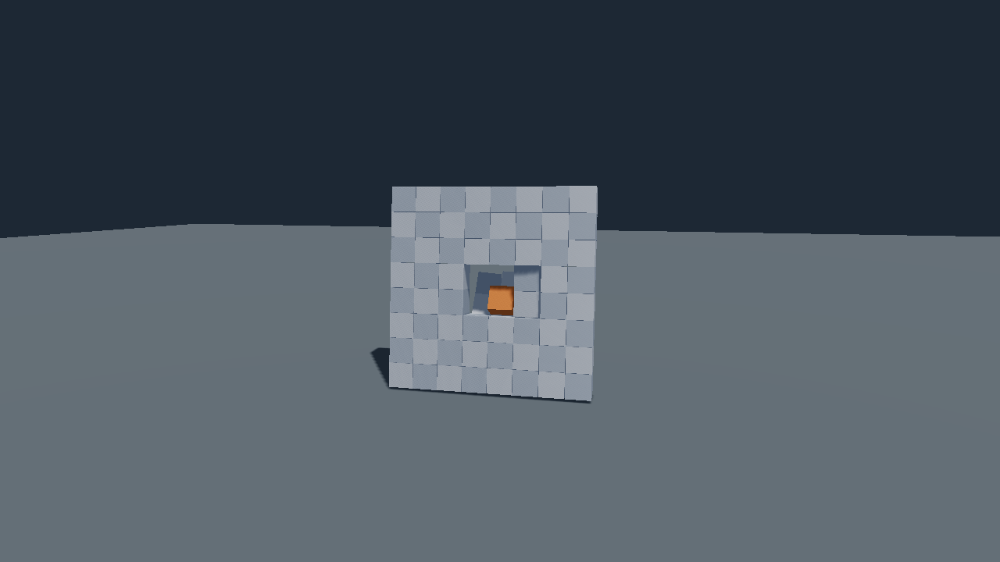

# Breakables

A `Breakable` is a set of rigid pieces joined by welds. By default the pieces move as one kinematic assembly until a
qualifying hit releases them into dynamic bodies, and each weld breaks when its force or moment limit is reached. The component, its descriptions and the world calls are in `c3d::physics`, in the [physics add-on](physics.md);
there is no feature flag. Fracture generation, which produces the pieces, lives in a separate project
([below](#fracture-generation)).



## Quick start

Pieces are mesh nodes below a root node. Inside a fallible function, with the physics world and `register_physics`
in place and the root's descendants authored:

```c3
scene.update_world();
world.add_breakable(root, physics::default_breakable_desc())!;

while (running) {
    scene.update_world();
    world.update(delta);
    foreach (event : world.breaks()) {
        on_break(event.root, event.piece_a, event.piece_b, event.point);
    }
    scene.flush_removals();
    scene.update_world();
}
```

`on_break` is application code. Node pointers in `BreakEvent` are frame borrows: consume them before
`flush_removals`. The `breakable` example builds a wall from a glTF model; run it with
`python3 scripts/build.py --example breakable`.

## Concepts

- **Piece.** A scene node with at least one collision hull and any number of render children. Hulls are convex and are
  independent of the render geometry. All hulls contribute to the piece's mass and centre of mass.
- **Weld.** A rigid joint between two pieces with a body-local frame in each and a unit moment axis. A broken weld is
  removed from the native world and reported once.
- **Anchor.** A weld between a piece and a static body outside the breakable. The application owns the target body;
  the `Breakable` owns only the anchor weld.
- **Form.** `ASSEMBLY` is one enabled kinematic root body carrying every piece's hulls; pieces stay parent-relative and
  follow the root. `PIECES` is one dynamic body per surviving piece, each node committed to world space. A qualifying hit
  on an assembly turns it into `PIECES`. `default_breakable_desc()` selects `ASSEMBLY`; `sleep_until_hit = false` creates
  `PIECES` directly. `wake_breakable(root)` performs the transition explicitly; on live `PIECES` it does nothing.
- **State.** `Breakable` is a pointer-sized component holding a pointer to library-owned state. Read it through
  `scene.get(root, Breakable).state`; keep the root id and reacquire the component after structural changes.
- **Breaking one weld need not split a piece.** A piece becomes free when every weld that holds it has broken.

## Create a breakable

| Call | Pieces | Graph |
| --- | --- | --- |
| `add_breakable(root, desc)` | Every `Mesh` node below `root`, one hull each | Derived from hull distances |
| `add_breakable_pieces(root, pieces, desc)` | `BreakablePieceDesc { node, hulls }` values | Derived from hull distances |
| `add_breakable_recipe(root, recipe)` | `BreakablePieceView` values with rest frames | Explicit welds and anchors |

All three attach, prepare and build in one call and remove their authoring when they fail. They share graph
construction, body creation, wake and rollback.

`add_breakable` needs a live root that is not the scene root and has no `Mesh`, with at least two `Mesh` nodes below it.
Each is an independent convex, volume-spanning piece with positive unit scale and no skin or morph deformation. Root and
piece world matrices are current, finite and rigid: bake scale into the asset. An `ASSEMBLY` requires `PARENT`
transform space on every node between a piece and the root; the root itself may use either space.

`add_breakable_pieces` takes a body node's `Entity` and ordered piece-local `GeometryId` hulls for each piece. At least
two distinct live descendants are required and no piece is an ancestor of another. Each piece has at least one live hull
and any number of render children; material boundaries do not create physical pieces. A glTF primitive becomes a
`Mesh` node, so group several primitives into one piece with explicit body parents. The supplied
`examples/assets/fractured_wall.gltf` has 64 separate one-primitive pieces with narrow seams.

Hull geometry stays in the asset store: it is needed again when a world is rebuilt. Hulls cook on preparation, so
`SOURCE_UNAVAILABLE` reports a hull whose CPU data was released with no cooked entry.

`BreakableDesc` fields:

| Field | Default | Meaning |
| --- | --- | --- |
| `break_force` | 2000 N (`DEFAULT_BREAK_FORCE`) | Weld reaction force that breaks an automatic weld. Finite, nonnegative. |
| `contact_distance` | 0.01 m (`DEFAULT_CONTACT_DISTANCE`) | Largest hull gap that creates a weld. Finite, nonnegative. |
| `density` | 1000 kg/m³ | Finite, positive. |
| `material` | dry friction | Contact `SurfaceMaterialDesc` of every hull. Independent of strengths. |
| `filter` | `FILTER_ALL` | `CollisionFilter` of every hull. |
| `hit_events` | false | Enables hit reports for the piece bodies in `PhysicsWorld.hits()`. An assembly always enables them so a hit can wake it. |
| `sleep_until_hit` | true | Starts as `ASSEMBLY`. |

The description, geometry identities and fracture layout are captured at creation. Recreate the breakable to change
them.

### Derived weld graph

Two pieces connect when the smallest distance between any of their hulls is at or below `contact_distance`. That
pair's closest points select the weld anchor; exact ties keep the first pair in caller hull order. Each unordered pair
of pieces has at most one weld. Edge and corner contacts count; the rule does not measure shared face area, and overlap
is accepted. In the example wall, 0.5 m cubes sit on a 0.508 m pitch: face gaps are below the default 0.01 m,
diagonal gaps are above it. Deriving the graph tests every piece pair; `PhysicsWorld.set_parallel` spreads those tests
over the application's workers with the same result for any worker count. Explicit recipes carry their own welds and
derive none.

## Explicit recipes

`BreakableRecipeDesc` holds ordered `BreakablePieceView` values, `BreakableWeldDesc` and `BreakableAnchorDesc` lists,
the physical `settings`, a default `strength` and an `evaluation` mode. Start from `default_breakable_recipe_desc()`.
The library copies every input. The weld and anchor lists are authoritative: an empty list creates no edges.

- A piece supplies its `Entity`, ordered hull ids and root-relative `rest_frame`.
- A weld names two distinct piece indices, a rigid frame in each piece and a unit `moment_axis` in frame A.
- An anchor names a piece and a target `Entity` that must have a live ordinary `STATIC` body when prepared. Frame A is
  local to the piece body's origin and frame B to the target body's origin, not their centres of mass.
- `Entity` values are scoped to the receiving scene; pass ids obtained from it.
- Place the target outside the breakable's subtree, for example as a sibling under a shared parent. Restrictions on
  independent bodies, joints, ragdolls and nested breakables still apply.

### Strengths

`BreakableStrength` has three finite, nonnegative limits:

| Field | Quantity | Unit |
| --- | --- | --- |
| `force` | Reaction force magnitude | N |
| `twist` | Absolute torque component along the world-space moment axis | N·m |
| `bending` | Magnitude of the remaining torque | N·m |

Zero enables a criterion at zero load; `float::max` disables it. `default_breakable_strength(force)` enables the force
limit (default 2000 N) and disables both moment limits. A piece's `has_strength` selects its copied value, otherwise it
inherits the recipe default; an anchor's `has_target_strength` does the same for its target. A weld takes the
componentwise minimum of its two endpoints, then `strength_override` replaces all three limits when
`has_strength_override` is set; an override may strengthen or disable a criterion.

`BreakableEvaluation.NATIVE_FORCE` (the default) uses box3d's force-threshold events. Enabled moment limits require
`SAMPLED_REACTION`, which reads every live weld's reaction after each fixed step, using the current native frame A for
its moment axis. It compares each magnitude with `>=` and reports force, then twist, then bending if several match.
The readings are stored post-step impulses divided by the substep duration: neither substep peaks nor outer-frame
averages, so a transient early in a step can be missed. Zero fixed steps produce no new sample.

## Prepare in two steps

`scene.attach_breakable_pieces(&assets, root, pieces, desc)` captures an automatic recipe and
`scene.attach_breakable_recipe(&assets, root, recipe)` copies an explicit one. Both work without a `PhysicsWorld`,
cooked hulls or native objects, and leave node poses and independent authoring unchanged. The caller's arrays may be
released afterward. `Breakable.is_prepared()` is false until preparation succeeds.

`world.prepare_breakable(root)` cooks the retained hulls and creates the requested initial form. It derives an
automatic graph or keeps the explicit one, checks that anchor targets are static bodies, and publishes new state only
after everything succeeded; the old state and its borrowed arrays become invalid. Preparing a prepared breakable does
nothing. A failure leaves the pending recipe, nodes and earlier owners unchanged and releases staged native objects;
correct the asset or capacity condition and retry. `prepare_breakable_subtree(root)` prepares every owner below `root`
(the whole scene when omitted) and returns the first failure after completing the others. Ordinary physics updates
leave unprepared owners pending, including after world replacement. `BodyStatus.PENDING` describes native rebinding of
prepared owners and is separate from `is_prepared()`.

The captured piece entities must be live at preparation; slot reuse does not replace them. Both recipe kinds check the
pieces' current relative poses before staging anything. The position tolerance is the larger of 0.0001 m and one
millionth of the largest absolute coordinate among the pair's current and captured positions; the angle tolerance is
0.0001 rad. A rigid motion of the whole piece set is accepted. A displaced connected piece returns `INVALID_ARGUMENT`
and the breakable stays pending until the placement is restored.
`breakable.preparation_mismatch()` returns a read-only `BreakableMismatch*` (`piece_a`, `piece_b` in copied order), or
null; it clears before each attempt and after success, and the borrow ends at the next preparation or removal.

## Read authoring

`state.piece_view(index)` returns the captured entity, hull ids, rest frame and optional strength.
`state.weld_view(index)` returns the piece indices, local frames, moment axis, effective strength and override.
`state.anchor_count()` and `state.anchor_view(index)` return copied anchor authoring and effective strength. The views
contain no native ids and no damage. Indices stay stable for the captured runtime after removals, so check entity
liveness. Reacquire the state and borrowed hull arrays after preparation or removal. Authoring the same automatic inputs
derives the same ordered graph.

## Wake and release

A hit by a dynamic body wakes an intact assembly when `mass * approach_speed >= break_force * fixed_dt` and the speed
passes the world's `hit_speed_threshold`. This heuristic is separate from weld evaluation. Only one qualifying hit per
assembly and step replays. Automatic wake starts from the native assembly pose; `wake_breakable` starts from the root's
authored pose. Fragments inherit the assembly's linear and angular motion, and the visitor's relative normal speed is
restored after a successful wake, which approximates first contact one step later. It is not an exact collision-history
reconstruction. An unanchored remainder may tip under a strong impact.

Wake is transactional for the surviving pieces. It first prunes pieces removed from the scene; that cleanup stays even
when construction fails. A failed wake keeps the remaining assembly and the visitor's velocity, releases its staged
objects and allows another request. A failed or pending form cannot be woken and reports `NO_BODY` until ready.

## Anchors and reset

Anchors constrain dynamic `PIECES` after a wake; an `ASSEMBLY` has no live anchor welds. Wake stages every piece body
and its internal and anchor welds before replacing the assembly.

An unbroken anchor rebinds when the same target entity acquires a replacement `STATIC` body. A missing or non-static
target makes it inactive and reports a binding failure, which is not a strength break; it binds again when the target
is usable. Deleting the target prunes the anchor permanently, even if its slot is reused. Broken edges stay broken
through body and world replacement until an explicit reset.

`world.reset_breakable(root, form, root_pose)` selects `ASSEMBLY` or `PIECES`:

```c3
world.reset_breakable(root, PIECES)!;
```

`root_pose` is an optional rigid world-space `maths::Transform*`; null uses the root's current pose. Reset returns
surviving pieces to their captured rest frames, repairs surviving internal edges and anchors that were not pruned, and
clears velocities and interpolation history. It does not recreate deleted nodes, regenerate geometry or move support
bodies. Zero survivors stay valid with no native body; one survivor creates the selected form's single body without
internal welds. Reset also prepares a pending or failed recipe once its inputs are ready. The requested placement must
agree with every surviving fixed anchor, including broken anchors the reset would repair, or reset returns
`INVALID_ARGUMENT`. Foreign bodies or joints attached to an owned body are rejected; unrelated joints on retained
support bodies are allowed.

Call reset on the owner thread outside native stepping and event consumption. A validation, capacity or construction
fault preserves the live form, poses, velocities, handles and damage while releasing staged objects. A successful reset
replaces the owned native handles, so reacquire body and joint handles afterward.


## Update and event order

```c3
scene.update_world();
world.update(dt);
foreach (event : world.breaks()) on_break(event.root, event.piece_a, event.piece_b, event.point);
scene.flush_removals();
scene.update_world();
```

Reports reset once per update and accumulate across its fixed steps. A full or zero-capacity report buffer increments
`dropped_events` and still allows wake and fracture. A single edge reports once per break and reset cycle.

| `BreakEvent` field | Meaning |
| --- | --- |
| `root`, `piece_a`, `piece_b` | Frame-borrowed nodes. |
| `root_id`, `endpoint_a`, `endpoint_b` | Entity ids. For an anchor, endpoint B is the borrowed target. |
| `edge_kind`, `edge_index` | `INTERNAL_WELD` or `ANCHOR`, and its index in the captured recipe. |
| `point` | The weld anchor through the current physics pose. Not an impact point or a seam centre. |
| `criterion` | `FORCE`, `TWIST` or `BENDING`. |
| `phase` | `NATIVE_THRESHOLD` or `POST_FIXED_STEP`. |
| `loads`, `limits`, `loads_available` | Sampled reports carry all three loads and effective limits. Native-threshold reports have `loads_available = false`, because the triggering load is unavailable. |

Within each breakable and fixed step, sampled reports follow weld index order, then anchor index order; native reports
keep native event order.

## Remove

Remove pieces through normal scene removal. The next update prunes their incident edges without a break report and
removes their collision shapes. World replacement does not resurrect them; removing all pieces leaves an empty valid
component. `world.remove_breakable(root)` removes the owned bodies and welds and keeps nodes and meshes, and world-space
piece transforms stay in world space. Removing only the raw component releases graph state and welds but leaves the
authored bodies for the application. Removing the root subtree releases everything.

## Faults

| Fault | Cause |
| --- | --- |
| `BREAKABLE_EXISTS`, `BODY_EXISTS` | An overlapping breakable, or an existing body in the subtree. |
| `c3d::INVALID_ID` | A dead piece, hull or anchor target. |
| `c3d::INVALID_ARGUMENT` | Empty hull lists, duplicate or non-descendant pieces, fewer than two pieces, a conflicting joint or ragdoll role, a displaced piece, a malformed weld or anchor frame, an anchor target that is not a static body of this world, or an invalid descriptor value. |
| `c3d::UNSUPPORTED` | A skinned, morphed or non-rigid piece, a non-`PARENT` path in an assembly, or an invalid captured rest frame. |
| `SOURCE_UNAVAILABLE` | A hull source whose CPU data was released with no cooked entry. |
| `c3d::CAPACITY_EXCEEDED` | Snapshot slots, recipe allocation or the parallel candidate list. |
| `NO_BODY` | An anchor target has no built body, or `wake_breakable` ran before the form was live. |

Native constructor and hull faults (`b3::INVALID_DEFINITION`, `b3::INVALID_HANDLE`, `b3::DEGENERATE_GEOMETRY`) pass
through. Every failed creation or attachment adds nothing. Automatic failures on a new world enter `build_failures()`;
a failed form needs an explicit reset with ready inputs or recreation. Source failures follow the revision retry
policy of ordinary bodies.

## Fracture generation

Fracture generation, its numerical kernel, surface construction and generator tests live in the standalone
[c3d_fracture.c3l](https://github.com/fesoliveira014/c3d_fracture.c3l) project under the `fracture` namespace, which
depends on c3d. This package accepts the authored hulls through `add_breakable_pieces` and keeps captured recipes,
preparation, welds, authoring views and break events. Core's store-free [glTF source inspection](gltf_source.md)
exposes independent encoded images, source indices, sampler values and extension names for fracture tooling.

## Serialization

With `C3D_PHYSICS_SERIAL` a `Breakable` saves its recipe and restores pending, without a world or native objects;
`prepare_breakable` creates the runtime afterward. Native ids, damage, measured reactions and velocities are not saved.
See [serialization](serialization.md#breakable-adapter).

## Limits

- Pieces are convex hulls; there is no runtime fracturing of a piece.
- The weld graph is fixed at preparation. Deleted pieces prune edges but no edge is added.
- Moment limits need `SAMPLED_REACTION`, which samples once per fixed step.
- Native record and replay include the body and joint changes but do not re-dispatch `BreakEvent` values.

## See also

- [Physics](physics.md), [physics inspector](physics_inspector.md), [serialization](serialization.md)
- [Collision queries](collision_queries.md) for the shared cooked hulls
