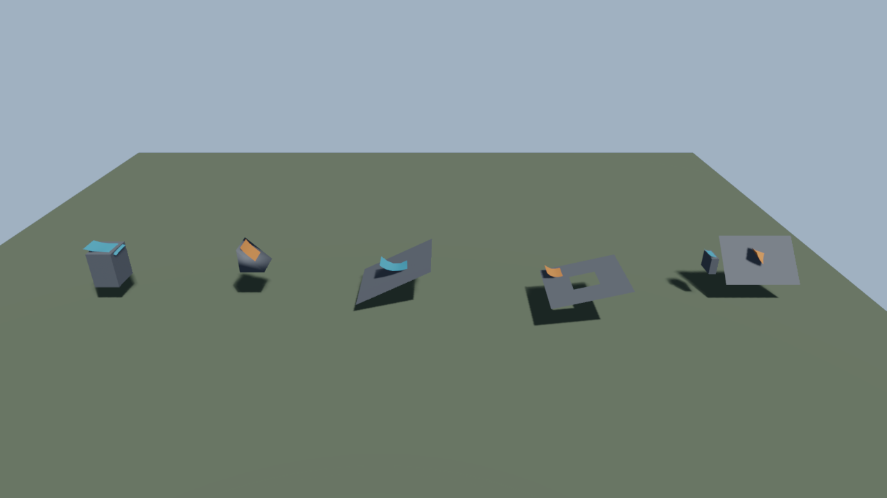
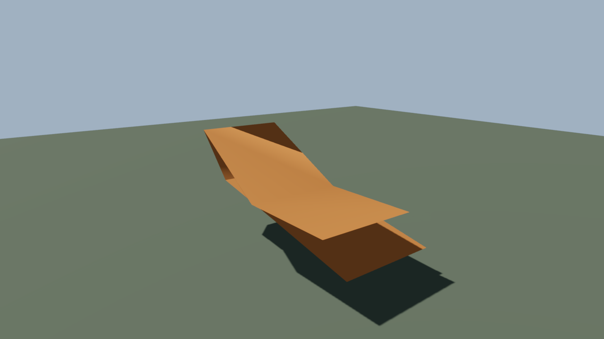
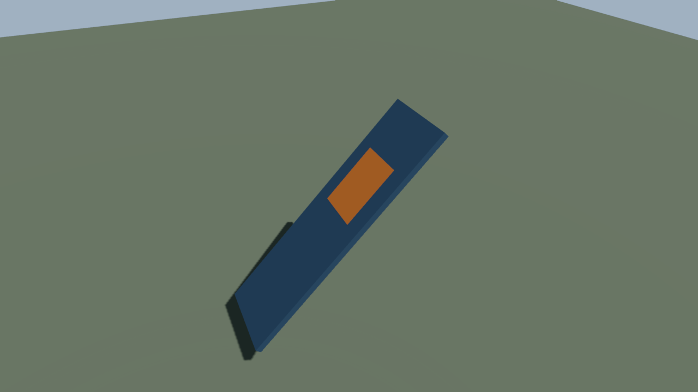

# Cloth

`c3d::physics::cloth`, in the physics add-on, simulates a triangle mesh with position-based
dynamics: unit-mass particles, an optional render-to-physical particle weld map (`render_particles`),
one distance constraint per unique physical triangle edge, distance or signed dihedral bending
across interior edges (`ClothBendMode`, `bend_compliance`, `ClothRestAngle`), gravity, node `Wind` drag,
damping, hard pins and weighted compliant XPBD attachments (`ClothAttachment`), deformed normal domains
and opt-in deformed tangent frames (`tangent_frame`, `tangent_uv_set`),
an optional ground plane and one-way particle contacts with every collider kind of listed
rigid bodies, plus opt-in self-contact between cloth vertices, faces and edges. It imports
the standard library, core and `c3d::physics`; it never creates GPU resources. Core supplies only editable geometry and
[vertex motion history](post.md#edited-vertices).

## Attaching

```c3
ClothDesc desc = cloth::default_cloth_desc();
desc.pins = pinned_vertices;
scene.add_cloth(&assets, flag_node, desc)!;
```

`Scene.add_cloth` copies the node's Mesh geometry into a private asset (positions, indices, UV and
color streams, computed normals, and optional tangents when `tangent_frame` is enabled), builds the constraints from the current world
positions, and replaces `Mesh.geometry` with the copy and enables `Mesh.vertex_motion`. The
source geometry is never written; two cloths on one source own separate copies. The node needs a
current, invertible world matrix. Pins and attachments are validated and coalesced onto physical particles; collider ids and
their binding metadata are copied (see [Collisions](#collisions)).

| Fault | Cause |
| --- | --- |
| `NO_MESH` | The node has no Mesh. |
| `CLOTH_EXISTS` | The node already carries a Cloth. |
| `c3d::INVALID_ID` | The Mesh geometry or a listed collider entity is dead. |
| `physics::SOURCE_UNAVAILABLE` | The source's CPU positions were released. |
| `physics::NO_BODY` | A listed collider node has no built RigidBody. |
| `c3d::UNSUPPORTED` | SkinBinding, morph weights or targets, joints, custom data, a bounds override, or a non-indexed or non-triangle topology. |
| `c3d::INVALID_ARGUMENT` | Zero substeps, iterations or contact capacities, non-positive or non-finite contact tolerance, a stiffness outside `[0, 1]`, negative or non-finite damping, thickness or bend compliance, non-finite gravity scale or ground height, invalid `render_particles`, missing or invalid UVs when `tangent_frame` is true, invalid or conflicting `attachments`, invalid `rest_angles` or non-manifold/inconsistent interior hinge winding, a pin, seam endpoint or index out of range, non-finite positions, a degenerate triangle, an edge shared by more than two triangles, or a collider listed twice. |
| `c3d::CAPACITY_EXCEEDED` | More than 32 listed collider owners, binding metadata exceeding `max_shapes`, a full geometry pool, state-size overflow, or a state block that cannot be allocated. |
| `cloth::CONTACT_PRECISION_EXCEEDED` | A captured native shape bound cannot be represented conservatively. |

Every fault leaves the Mesh, the component store and the asset counts as they were. Defaults: 4
substeps, 8 iterations, stretch stiffness 1, bend stiffness 0.5, damping 0.5 per second,
thickness 0.01 m, gravity scale 1, no pins or attachments, identity particle mapping, normal-only publication (`tangent_frame = false`, `tangent_uv_set = 0`), `ClothBendMode.DISTANCE`, `bend_compliance = 0`, no rest-angle overrides, no ground, no colliders.
`default_cloth_desc()` also installs the [collision defaults](#collisions).

`Scene.remove_cloth` restores the source geometry and the previous `vertex_motion`, then removes
the component, whose hook removes the private geometry and frees runtime and authoring storage. Removing the
node runs the same hook. The state outlives `destroy_physics_world`; destroy the scene before the
asset store. While attached, do not replace or remove the Mesh, release the private geometry's CPU
streams, change its topology, remove the source asset, or write the library-owned `ClothState`.
To change pins, attachments, settings or the source, remove and attach again.

### Physical particles, normal domains and tangent frames

When `ClothDesc.render_particles` is empty, each source vertex is its own physical particle. When
supplied, `render_particles.len` must match the source vertex count, map onto a dense range
`0..particle_count - 1` (`particle_count >= 3`) with every physical particle referenced by a triangle,
and map co-shared render vertices to identical rest positions. Co-shared render vertices that share an
authored unit normal (within `1e-6`) share a normal domain so UV seams stay smooth while hard creases
stay split.

When `ClothDesc.tangent_frame` is true, `tangent_uv_set` (`0` for `uv0`, `1` for `uv1`) selects a
populated finite UV stream. Preparation runs Mikk tangent generation on the source mesh to establish
tangent domains and handedness signs (`w = ±1`), and each publication recomputes angle-weighted
orthonormal tangents from the deformed triangles. Degenerate UV triangles fall back deterministically
through accumulated corner tangents, the last committed tangent, the rest tangent transported by the
reference triangle's current frame, and a world-axis projection. `Mesh.trace` is the
application's choice. A traced cloth takes a vertex-motion posed slot: each simulation revision copies
positions and normals into the slot and refits the trace data instead of rebuilding it, and the top level still
rebuilds every revision. See `docs/scene_trace.md`, "Vertex-motion slots".

### Attachments and dihedral bending

`ClothDesc.attachments` supplies `ClothAttachment { uint particle; float weight; float compliance; }`
records on physical particles (`weight` in `[0, 1]`, `compliance >= 0`). Legacy `pins` map through
`render_particles` as hard attachments (`weight = 1`, `compliance = 0`). Zero-weight entries are
ignored. When `compliance == 0` and `weight > 0`, the particle is a hard pin (`inverse_mass = 0`).
When `compliance > 0` and `weight > 0`, the particle retains unit mass (`inverse_mass = 1`) and is
pulled toward its interpolated anchor each substep by a compliant XPBD positional attachment with
`effective_compliance = compliance / weight`. Duplicate entries on one particle must agree on hard vs
soft and on `effective_compliance`.

Setting `ClothDesc.bend_mode = DIHEDRAL` replaces opposite-vertex distance bending with an analytic
signed dihedral hinge constraint across each interior physical edge (`ClothBendMode.DISTANCE` remains
the default and requires `bend_compliance == 0` and empty `rest_angles`). `ClothDesc.rest_angles`
overrides the rest angle on canonical interior edges (`first < second`, `angle` in `(-pi, pi]`). Each
substep projects hinges with XPBD compliance `bend_compliance`; a substep's corrections turn a hinge
at most 1.25 rad away from its tracked angle, so a hinge far from rest recovers over several substeps
along its tracked winding without changing the compliant equilibrium. The continuous motion of each
substep is certified against edge collapse, triangle degeneracy, and a half turn or more
(`cloth::BEND_UNRESOLVED`).

### Skinned reference, transport and `CrowdCloth`

An ordinary mesh node carrying a valid `SkinBinding` is supported as a skinned cloth owner. While
pending, the owner retains both `Mesh` and `SkinBinding`. Preparing the cloth (`cloth::prepare(&scene, &assets, node, &physics)` or `scene.add_cloth(&assets, node, desc, &physics)`) moves the rendered
`Mesh` to an owned unskinned child node carrying transient `ClothOutput` while leaving `SkinBinding`
on the owner node so skeletal animation and skinning evaluation continue undisturbed. `Scene.remove_cloth`
and `Scene.remove_crowd_cloth` are the only valid component removal paths: they restore the source
`Mesh` or hidden crowd batch, increment `Mesh.vertex_history_token` to invalidate correspondence-based
motion blur and trace caches, and delete generated `ClothOutput` child nodes (calling `scene.remove_component`
directly releases private state and geometry without undoing child/mesh takeover; whole-node `scene.remove(owner)`
removes child nodes with the owner).

`ClothDesc.transport` supplies an optional per-particle weight in `[0, 1]`, indexed by the physical
particle (`render_particles` maps render vertices to particles). During each fixed step, free particles
receive `transport[p] * (current_ref[p] - solved_ref[p])` before gravity and constraint projection so
skeletal motion carries the cloth naturally without double-counting on zero-step frames.

For `AnimatedCrowd` owners, `scene.attach_crowd_cloth(&assets, crowd_node, part, desc)` attaches a
`CrowdCloth` part recipe for a rigid or skinned crowd mesh part (`sway` and `fade` must be disabled),
and `cloth::prepare_crowd_cloth(&physics, &assets, crowd_node)` hides the part's `InstancedMesh` batch
and creates one unskinned `ClothOutput` child node per crowd placement slot. Active slots (`slot < crowd.count`)
are simulated and published in owner-local space with per-slot geometry vertex colors equal to the
source vertex colors (or white) multiplied by `crowd.colors[slot]`; inactive slots are hidden, and slot
generation changes reseed the slot and advance `Mesh.vertex_history_token`.

### Authored cut paths and tearing

`ClothDesc.cuts` lists authored `ClothCutPath { uint id; uint[] vertices; bool strain_trigger; float strain_threshold; }`
chains over physical particle IDs (`id != 0`, unique across the cloth, `vertices.len >= 2`, consecutive
vertices connected by an interior physical edge). `ClothDesc.tears` (`ClothTearLimits`) configures
`max_requests` (default 0, defaulting to `cuts.len`) and `opening_iterations` (default 32). Preparation
pre-splits material vertices across potential cut sectors and computes rest-area mass shares and
partitioned soft-attachment compliances so runtime cuts allocate nothing and never rewrite the triangle
index buffer.

Call `cloth.request_cut(id)` (or `crowd_cloth.request_cut(part, instance, id)`) on a prepared owner to
queue an explicit cut for the next performed substep, or enable `strain_trigger = true` with a positive
`strain_threshold` so the path triggers when an intact interior edge along the path satisfies
`(length - rest_length) / rest_length >= strain_threshold`. Triggered and requested paths are processed
in ascending `id` order. When `self_collision` is enabled, newly split seam pairs are separated by a
centroid-conserving half-space opening solver and certified over the affine `t in [0, 1]` trajectory
(including positive-thickness CCD resweep when `continuous` is enabled) before committing and advancing
`Mesh.vertex_history_token`. Any uncertified opening rolls back the entire cloth update with
`cloth::OPENING_UNRESOLVED` (`stage == OPENING`) and records `ClothCutOutcome.REFUSED` (`failure == cloth::OPENING_UNRESOLVED`, `stage == OPENING`) in
`cloth.cut_result(id)`. Refused strain-triggered paths latch (`outcome == REFUSED`) so subsequent updates
do not re-trigger the same automatic path and freeze the cloth; explicit `request_cut(id)` calls can retry a
refused path.

The opening moves positions only: split particles keep their parent's velocity, so a cut conserves
momentum and adds no separation speed. Continuous self-contact between vertices of a torn seam (active
particles that share a base particle) raises each movable vertex's response share to at least 0.25 so
the coincident halves separate; every other contact keeps its barycentric response.

## Pending authoring and preparation

The shared [owner readiness table](owner_readiness.md) records preparation order
and pending draw behavior.

`scene.attach_cloth(&assets, node, desc)` validates and attaches authoring without
creating a private geometry asset or simulation state. `Cloth.authoring` owns the
source geometry identity, original `vertex_motion` flag, complete descriptor and
copies of the requested pins, seam pairs and collider identities. Its arrays are read-only.
Requested pin order and duplicates are retained; preparation builds the separate
sorted, deduplicated simulation pin list.

`Cloth.is_prepared()` is false until `cloth::prepare(&scene, &assets, node, world)`
installs the complete runtime and switches the Mesh (or generated `ClothOutput` child for skinned owners) to its private geometry.
Until then the existing Mesh remains unchanged and draws the authored source.
Attachment validates retained source streams and pin/contact identities;
world-space triangle constraints and native body readiness are validated during
preparation, after node world matrices are current. Skinned cloths and `CrowdCloth`
require a non-null `PhysicsWorld*` with `world.scene == &scene` and `world.assets == &assets`.
Actual compound leaves are resolved
and counted during the first update and again when bindings change; preparation success
does not guarantee that those leaves fit `max_shapes`.

For listed contact owners, run the ordinary physics update first so their
`PhysicsBody` authoring acquires `RigidBody` mirrors. Preparation before that
returns `physics::NO_BODY` and leaves cloth pending. A rigid cloth with no listed
contact bodies has no native-world preparation dependency.

`cloth::prepare_subtree(&scene, &assets, root, world)` attempts every pending `Cloth` and `CrowdCloth`
under a root, including the root. Omit root or pass null for the whole scene.
It returns the first fault and retains successful owners. Every failed owner
keeps its source Mesh and authoring and releases staged private geometry/state.
Repeated preparation of a prepared owner is a no-op.

`PhysicsWorld.update_cloths` skips pending owners without changing their source
Mesh or authoring, and reports their count in `cloth_stats.pending`. Normal
prepared-cloth timing and update order are unchanged. `Scene.add_cloth` remains
the combined attachment-and-preparation entry; its failure removes the partial
authoring too. `Scene.remove_cloth` and `Scene.remove_crowd_cloth` also remove pending authoring and restore the captured
source geometry, batch visibility and vertex history token.

## Collisions

```c3
ClothDesc desc = cloth::default_cloth_desc();
desc.pins = cape_pins;
desc.colliders = bone_entities;
scene.add_cloth(&assets, cape_node, desc)!;
```

`ClothDesc.colliders` lists up to `MAX_CLOTH_COLLIDERS` (32) entity identities. Their
`RigidBody` mirrors must exist before preparation. Contacts support SPHERE, CAPSULE,
BOX, HULL, MESH, HEIGHT_FIELD and COMPOUND. Boxes and hulls are closed solids;
mesh and heightfield triangles are two-sided surfaces, with heightfield holes empty.
A compound is the union of its transformed children. Ground remains the optional
plane at `ground_height`.

External contact samples cloth particles only, using `thickness` as the separation
offset. A small collider can pass through an unsampled part of a large cloth face
without touching a particle. Success does not guarantee full cloth-triangle/body
nonintersection. Contacts are one-way: cloth applies no impulse to bodies. Discrete
contact is the default; `continuous` enables swept particle contact. Shapes follow final
scene body poses, not rendered skin.

The private physics adapter checks entity, native world/body and cooked-snapshot
generations during each owner-thread update. Missing owners or bodies contribute
nothing; a reused entity slot never binds. Native replacement refreshes bounded
binding metadata. Snapshot data is borrowed only inside the update, and no raw native
pointer survives it. Meshes are enumerated through a containing native query, then filtered
against the local particle bounds before consuming candidate capacity. Heightfield queries
use conservatively expanded cell ranges. Neither path copies the whole cooked asset into
each cloth; compound children use their owning compound's accessors.

Shapes use rigid physics' baked dimensions and local transforms. Native getters supply
the actual baked hull geometry and mesh scale. The final scene body's translation and
rotation place them; body node scale is not applied again. The existing native shape
domain requires positive heightfield scale and nonzero mesh scale; mirrored mesh scale
is supported. Cloth adds no separate scaling convention.

Each solved substep interpolates from the body's last solved pose to its final scene
pose using shortest-path rotation. First observations and replaced or previously missing
bodies use the current pose on both sides. Separate solved and published observations
keep zero-step publication from advancing solved positions, velocities or body poses.
Pinned particles are never projected against bodies or ground. Their overlaps are
excluded from separation enforcement and reported in `pinned_overlaps`.

`ClothDesc.collisions` holds a `ClothCollisionDesc`. `default_cloth_collision_desc()`
and `default_cloth_desc()` provide these values:

| Field | Default | Meaning |
| --- | ---: | --- |
| `contact_tolerance` | 0.0001 m | Maximum accepted separation deficit after float publication. |
| `contact_iterations` | 8 | Final contact passes per substep or publication. |
| `max_shapes` | 128 | Flattened collider leaves across the listed owners. |
| `max_candidates` | 8192 | Candidate pairs retained in one pass. |
| `max_contacts` | 4096 | Active contact records and composed impact responses. |
| `self_collision` | false | Vertex-face and edge-edge contact within this cloth. |
| `continuous` | false | Sweep external contact and enabled self-contact. |
| `max_ccd_iterations` | 64 | Distance advances per candidate path. |

Tolerance must be finite and positive; iterations and capacities must be nonzero.
Preparation sizes staging and contact buffers with checked arithmetic. Updates allocate
nothing and never grow or truncate these buffers. Change settings or the owner list by
removing and attaching the cloth again. The default capacities are finite limits, not
a guarantee that arbitrary collider sets fit.

Each structural pass is followed by a contact pass. Up to `contact_iterations` final
passes then resolve ground, body and enabled self contacts together and check the complete
residual. Successful publication leaves every participating free particle at external
separation of at least `thickness - contact_tolerance`. Unresolved competing constraints fail the cloth update.

## Self-contact and seams

```c3
ClothSeam[2] seams = { { .first = 4, .second = 12 }, { .first = 5, .second = 13 } };
ClothDesc desc = cloth::default_cloth_desc();
desc.collisions.self_collision = true;
desc.seams = seams[..];
scene.add_cloth(&assets, node, desc)!;
```

Self-contact checks both vertices against source faces and disjoint source-edge pairs
within one Cloth. Successful publication has unsigned closest separation at least
`2 * thickness - contact_tolerance` for each eligible pair. Enable `continuous` to prevent
crossing along the checked motion paths. Different Cloth components do not collide with each other.

`ClothDesc.seams` copies pairs of source vertex indices. Preparation takes their transitive
equivalence; duplicate and identity pairs are harmless. A vertex/face pair is excluded if
the vertex is equivalent to a face corner or shares a source edge with one after applying
that equivalence. An edge pair is excluded if any endpoint pair is equivalent or shares
such a source edge. Exclusion covers incidence and one edge ring, not a whole connected
component. Coincident positions alone never create equivalence. Seams change only collision
exclusions; they do not join particle positions or add mechanical constraints.

Source face and unique edge identities stay fixed while expanded bounds are rebuilt and
sorted in prepared storage each pass. Self and external contacts share `max_candidates`
and `max_contacts`; dense folds can exceed those limits. Response uses inverse-mass-weighted
vertex/face and edge/edge corrections. Pins have zero response weight and stay exact. A
movable feature separates from fixed features; a conflicting fully pinned eligible pair
fails with `CONTACT_UNRESOLVED`. Collapsed intermediate features use a checked reduced
case when an axis is available, or fail with `CONTACT_PRECISION_EXCEEDED`. They are never
discarded as separated. Bounded passes can also fail on competing constraints; increasing
`contact_iterations` allows more work without promising convergence for every fold.

## Continuous contact

```c3
ClothDesc desc = cloth::default_cloth_desc();
desc.collisions.continuous = true;
desc.collisions.self_collision = true;
scene.add_cloth(&assets, node, desc)!;
```

Continuous mode checks the proposed movement from each accepted configuration: velocity
prediction with pins, each edge/bend correction batch, and contact corrections. Moving
bodies use linear translation and shortest-path rotation between the final scene poses
observed by successive updates. This does not recover motion omitted from those poses.
The broad phase includes the rotational arc. Responses keep their curved paths and are
checked against all selected contacts before the next configuration is accepted.

The configured distance-advance bound applies to each candidate path. Exhaustion or a
stalled advance reports `CONTACT_NONCONVERGENT`; unresolved initial overlap or competing
constraints can report `CONTACT_UNRESOLVED`. Numerical uncertainty reports
`CONTACT_PRECISION_EXCEEDED`. A failed path is never accepted as a miss. Prepared contact
capacity also bounds composed responses; neither convergence nor capacity is guaranteed
for arbitrary motion or topology.

A zero-step update sweeps from the last published positions and body observations to
the proposed publication using the current final pins and bodies. It leaves solved
positions, velocities and solved pin/body anchors intact. The next performed step still
starts from those solved anchors. A performed step publishes its accepted final state.

`PhysicsWorld.teleport` resets the affected body's observations in referencing cloths
after writing its new pose. Call `cloth::reset_contact_history(Cloth*)` after directly
teleporting a listed collider through scene transforms. Reset and body replacement use
current poses on both sides of the discontinuity; endpoint contacts still apply. Reset
does not teleport the fabric or change its velocity. Ordinary pose edits without reset
remain continuous motion.

## Arithmetic and update failures

Consumers using cloth must compile with `--fp-math=strict`, or `"fp-math": "strict"`
in their project settings. The update's owner thread must use round-to-nearest and
gradual underflow. Runtime checks detect unsupported arithmetic conditions but do not
prove the compiler's floating-point mode. Cloth never changes thread or process modes.

Every prepared cloth exposes its read-only last-attempt result as
`cloth.state.contact_result`. `failure` is zero on success; `stage` identifies failure
in ARITHMETIC, BINDINGS, ATTACHMENT, BEND, CANDIDATES, CONTACTS, RESOLVE, PUBLICATION, MATERIAL or REEXPRESSION,
and is NONE on success. `candidates` and `contacts` count observed work;
`peak_candidates` and `peak_contacts` report the largest retained sets. `max_residual`
and `unresolved` describe the last checked participating constraints, and
`pinned_overlaps` counts excluded pin overlaps. A failed attempt does not report
unvisited work as checked.
`sweeps`, `ccd_iterations`, `impacts` and `resweeps` report continuous work;
`vertex_face_impacts` and `edge_edge_impacts` identify the self-contact events.

| Fault | Meaning |
| --- | --- |
| `c3d::CAPACITY_EXCEEDED` | Binding, candidate or contact storage is full; `stage` identifies the buffer. |
| `cloth::CONTACT_UNRESOLVED` | The bounded contact passes could not satisfy all participating constraints. |
| `cloth::CONTACT_NONCONVERGENT` | A CCD advance stalled or exhausted its iteration bound. |
| `cloth::CONTACT_PRECISION_EXCEEDED` | Arithmetic, correction or float publication cannot establish the configured tolerance. |
| `cloth::BEND_UNRESOLVED` | A dihedral hinge collapsed, became non-finite, or turned half a revolution within one substep. |
| `cloth::FRAME_UNRESOLVED` | Deformed normal or tangent frame reconstruction could not produce a finite unit frame. |
| `cloth::OPENING_UNRESOLVED` | A requested or strain-triggered cut path could not be opened and certified within its reserves and tolerances. |

An update stages all performed substeps, velocities, pin/body observations and publication
before committing. On failure it keeps the last committed simulation and histories,
updates diagnostics and continues other cloths. It does not replay failed elapsed steps
through another accumulator; the next normal update retries current inputs from committed
cloth state.

With an unchanged cloth-node transform, failure preserves geometry bytes and revision.
After a node or parent moves, cloth re-expresses its committed world publication in the
new local frame only if the inverse and local float positions are finite and their world
round trip differs by at most `contact_tolerance`. The complete replacement geometry is
checked before publication; only a changed local representation advances its revision.

If re-expression is unsupported, the result is `CONTACT_PRECISION_EXCEEDED` at
REEXPRESSION. Committed world-space simulation and histories, old local geometry bytes
and revision remain unchanged. The application-owned transform is not rolled back, so
the old local geometry may render elsewhere. Restoring a supported transform lets later
updates retry. World-surface preservation is not guaranteed under an unrepresentable
transform.

With `C3D_PHYSICS_SERIAL`, Cloth authoring version 7 and CrowdCloth authoring version 2 store
collision settings, requested pins, typed seam pairs, collider references, `render_particles`,
`tangent_frame`, `tangent_uv_set`, `attachments`, `bend_mode`, `bend_compliance`, `rest_angles`,
`transport`, `cuts` (`ClothCutPath`) and `tears` (`ClothTearLimits`). Older JSONC payloads default
`tears` to `default_cloth_tear_limits()` (`opening_iterations = 32`, `max_requests = 0`) and other newer fields to empty/false/`DISTANCE`/`0`.
Version-1/2/3 JSONC defaults `continuous` to
false and `max_ccd_iterations` to 64. Version-1/2 also defaults self-contact to false and
seams to empty; version-1 receives the discrete collision defaults. Incompatible older
binary layouts return `c3d::UNSUPPORTED` before destination mutation. Restored cloth
remains pending. Runtime contacts, diagnostics, native identities, velocities, buffers,
cut state and histories are never serialized.

## Frame order

```text
animation -> scene.update_world -> physics.update
          -> final ragdoll/IK poses -> scene.update_world
          -> physics.update_cloths -> render every view
```

Call `PhysicsWorld.update_cloths` exactly once after each `PhysicsWorld.update`; its contract
checks `cloth_update_serial != update_serial`. Do not change the scene or assets between it and
recording the frame's views. It consumes `steps_last_update` performed fixed steps (dropped backlog
is not replayed) as `steps * substeps` substeps of `fixed_dt / substeps`, and reads `fixed_dt`
and `gravity` from the world tuning, so keep those unchanged between the two calls.

Pins follow the node's final world pose. Each pin keeps the world anchor of its last solved
substep and is interpolated to the current anchor across the update's substeps, landing on it
exactly on the last one. Free particles stay in world space: moving the parent does not drag
them. A zero-step update integrates nothing and keeps the solved anchors; it publishes the solved
positions with pins at the current anchors (contact correction touches that publication only), so
attachment holds without inventing elapsed time, and a later step interpolates from the last
solved anchors.

## Parallel staging

`PhysicsWorld.set_parallel(ParallelFor)` lets the application run cloth staging on its own worker
threads. `ParallelFor` holds a function `run(context, range, data, count, batch)` and its `context`: `run`
calls `range(data, first, count)` over `[0, count)` in batches of `batch` items, in any order and
concurrently, and returns only after every range finished. A zero `ParallelFor` (the default, or
`set_parallel({})`) stages on the calling thread. Physics imports no job library; `ParallelRangeFn` has
`c3d::job::RangeFn`'s signature, so a `JobPool` adapter is a few lines:

```c3
fn void run_on_pool(void* context, ParallelRangeFn range, void* data, uint count, uint batch) {
    JobPool* pool = context;
    pool.wait(pool.run(range: range, data: data, count: count, batch: batch));
}
```

`update_cloths` runs three phases:

1. **Collect**, serial. It checks ownership of each prepared cloth and crowd slot, reconciles crowd slot
   outputs, handles held cloth and held slots (their ownership check and the mirror of the owner's layers,
   world matrix and visibility onto an output node), and lists every other prepared ordinary cloth and active
   crowd slot in ECS order: ordinary cloth first, then crowd slots by owner, part and slot.
2. **Stage**, through `ParallelFor`, one range item per listed cloth or slot. An item runs the whole update
   up to its material frames (reference sampling, collider refresh, the solve, contact passes, tearing,
   publication staging and the rest probe) and then copies its accepted result into its own `ClothState`.
   An item records its fault and its outcome in its state and nothing else.
3. **Commit**, serial, in the list's order. For each item it copies the changed vertex ranges into the
   private geometry and marks them dirty, resets vertex histories, writes the output node (layers, world
   matrix, visibility, crowd slot generation and instance), re-expresses a failed item's mesh, and adds the
   item to `ClothStats`.

A staged item reads the scene (nodes, components, transforms), the asset store (source geometry,
skeletons, models) and the box3d shape data of its listed bodies, and writes only its own `ClothState`. The
box3d queries it uses (the shape getters, bounds, `query_mesh` and `query_height_field`) only read. It
allocates nothing and uses no temp allocator, so `run` may call `range` from any thread, including threads
that never touched the allocator. Scene writes, asset-store marks, `ClothStats` and every other shared
write happen in phases 1 and 3, on the calling thread.

**Thread-safety contract.** While `update_cloths` runs, the application must not mutate the scene, the asset
store or the physics world, and must not step the world: workers read all three. The calling thread owns
`update_cloths` and `set_parallel`; do not call `set_parallel` during an update.

**Determinism.** One cloth's arithmetic is the same on every thread, and items share no mutable state, so
positions, velocities and published geometry are bit-identical to the serial path for every worker count
and range order. A failing item does not stop the others; it is re-expressed in phase 3 as before.

Parallelism is across cloths and crowd slots. One cloth still solves on one thread, so a scene of a single
large cloth sees no gain. `ClothStats.solve_seconds` is the sum of the items' solve times, which is CPU time
and can exceed the frame under parallel staging; `stage_seconds` and `commit_seconds` are the wall times of
phases 2 and 3.

Every `ClothState` carries a small work record, and the world keeps one pointer per scene node slot for the
list. A crowd slot's state also owns its joint palette scratch, 64 bytes per joint, so slots do not share a
buffer.

## Rest and holds

A cloth is `AWAKE`, `RESTING` or `HELD` (`ClothActivity`). `Cloth.activity()` reports it;
`CrowdCloth.slot_activity(slot)` reports a crowd slot, which is `RESTING` when every prepared part of
the slot rests.

**Resting.** `ClothDesc.sleep_speed` (m/s, default 0, which never rests) and `sleep_steps` (default 30)
set the rule. After each update that performed steps, if no particle with a nonzero inverse mass moves
at `sleep_speed` or faster, the update's steps join a run; otherwise the run resets. The cloth rests
when the run reaches `sleep_steps`. Zero-step updates neither count nor reset the run. Resting zeroes the
velocities and records the owner's `Wind` (its presence and value), the world gravity and the pose of
every listed collider body.

**Triggers.** A resting cloth still samples its reference and its collider bodies each update, and wakes
for any of these:

- Any particle's reference moved from its last solved position by more than `sleep_speed * fixed_dt`.
  This covers rigid owners, skinned owners, pins, attachments and transport.
- A listed collider body moved by more than that distance while its placed shape bounds overlap the
  cloth's world bounds expanded by `thickness + contact_tolerance`. A rotation counts as moving the
  shape's farthest bounding point.
- The owner's `Wind` appeared, was removed or changed value, or the world gravity changed.
- A listed body went live or dead, or had its contact history reset by `PhysicsWorld.teleport`,
  `cloth::reset_contact_history` or a rebuilt shape.
- A cut request is pending.
- The application called `wake()`.

**Holding.** `Cloth.sleep()` and `CrowdCloth.sleep_slot(slot)` hold a cloth, awake or resting, from the
next update and zero its velocities. A held cloth ignores every trigger and a cut request stays pending
until `wake()` (`wake_slot(slot)`). A hold set on a pending cloth applies when it prepares. Holds are
runtime state; the application decides them, and the library never holds a cloth for visibility.

Holds are meant for unseen cloth. A held cloth stays as published: a held skinned cloth stays frozen in
its owner's frame while the skeleton animates, and a held crowd slot keeps its last colour. A hold on a
crowd slot ends when the slot gets a new instance, so the new instance starts awake.

**Waking.** The first update after a wake carries the particles to where the reference went while the
cloth stopped, sets velocities to zero, makes the solved reference the current one and sets pin and
attachment anchors equal to their targets. A held or resting cloth draws at fixed node-local positions, so the
carry depends on the reference:

- A cloth on a rigid owner (a Mesh node without a `SkinBinding`) moves rigidly by
  `node.world * inverse(published_frame)`, the owner's motion since the last publication. The drawn shape
  and every edge length hold under rotation as well as translation.
- A skinned cloth and a crowd slot move each particle by `current_reference - solved_reference`, which keeps
  pins and free particles consistent. A crowd slot cannot use its owner's motion: it draws under the owner
  node while its reference follows the instance placement. A reference that rotated while the cloth was
  held shears these two; holds are for unseen cloth.

An explicit `wake()` also resets the listed bodies' pose history, so a collider that moved while the cloth
was held does not sweep through it. A wake is committed with the update that carried it: if that update
fails, the cloth keeps its activity and positions, and the wake request stays pending.

**Skipped work.** A resting cloth skips the solve and publication after its trigger check; a held cloth
skips everything after the ownership checks except mirroring the owner's layers, world matrix and visibility
onto a skinned or crowd output node. Neither marks geometry dirty, so the renderer sees no new
revision. A resting crowd slot still publishes an instance colour change. `ClothStats.resting` and
`ClothStats.held` count the cloths that skipped the update; `particles` and `constraints` sum the cloths
that simulated.

Activity and holds are not serialized. A restored cloth is pending, then awake; `sleep_speed` and
`sleep_steps` are authored and serialized.

## Rebasing the origin

Cloth state is world-space, so `PhysicsWorld.shift_origin(&scene, offset)` subtracts the
offset from `positions`, `predicted`, `published`, the pin and soft-attachment anchors and targets, the
collision shape endpoints, solved/published/rested body observations and world-space sweep
scratch. A resting or held cloth keeps its activity. Cached path certificates are discarded and rebuilt on the next update.
Velocities are unchanged.
Publication is node-local through the inverse of the node's world matrix, and the cloth
node is an ordinary parent node moved by `Scene.shift_origin`, so the published vertices
do not change. `ground_height` is a world height and is not shifted.

## Solver and publication

Per substep: wind accelerations from each triangle's area, unit normal and relative air velocity
(`Wind.velocity` minus the mean corner velocity, clamped to `max_speed` when it is positive), as
`drag * area * dot(relative, normal) * normal`, one third per corner; semi-implicit integration
of gravity and wind; damping `max(0, 1 - damping * dt)`; prediction; hard pins; then `iterations`
passes over soft XPBD attachments, edges, distance or dihedral bends, the ground with its thickness offset, and
the collider shapes and enabled self contacts, followed by bounded final contact resolution;
velocities from the corrected displacement. A stiffness `s` is applied per pass as
`1 - (1 - s)^(1 / iterations)`, which normalizes one isolated constraint, not a coupled mesh. A
pair that collapses onto one point separates along its rest direction. `Wind.lift` is unused.

Particles have unit mass, so the wind's effect falls as a mesh gets finer; scale `Wind.drag` with
vertex density (the example uses `2.5 * vertices / area`) to keep a response.

Publication converts world positions through the inverse current node matrix into the private
geometry, recomputes normals, optional tangents and bounds, and publishes changed ranges: for each of
the position, normal, optional tangent and crowd colour streams it finds the first and last material
vertex whose value differs from the geometry, copies only that span and calls
`mark_geometry_range_dirty` once for the stream. Unchanged streams are not marked; unchanged output
keeps the revision. Publication checks reconstructed
world positions and contact separation before writing any stream. Solve and publication allocate nothing
after preparation (the CPU triangle tree rebuilds only when a query asks for it).
`PhysicsWorld.cloth_stats` holds the last update's solve and publication seconds, the wall seconds of the
staging and commit phases, particle count
and constraint count of the simulated cloths, pending owners skipped, resting and held cloths skipped,
failed cloth count, observed candidate/contact counts, CCD iterations, impacts and maximum reported
residual.

A revision uploads only the changed vertex range of each changed stream (counted in `Stats.upload_bytes`;
see [Publishing geometry edits](post.md#publishing-geometry-edits)). When every vertex changes that is
24 bytes per vertex (40 bytes per vertex when `tangent_frame` is enabled): 26,136 bytes for the
33×33 benchmark flag. A whole-block upload of the same flag is 47,264 bytes
(positions, normals, UV and 16-bit indices). Each temporal view additionally
writes 12 bytes per vertex of previous positions through the frame ring, 13,068 bytes for that
flag, counted in `Stats.vertex_history_bytes`.

## Example

```text
python scripts/build.py --example cloth
addons/c3d_physics.c3l/build/cloth.exe [--scene flag|cape|both|contacts|fold|fast|field|crowd] [--count 64] [--workers 4] [--hold] [--still] [--frames 300]
c3c build cloth --path addons/c3d_physics.c3l -O3
addons/c3d_physics.c3l/build/cloth.exe --benchmark --scene flag|cape|both|contacts|fold|fast|field|crowd [--count 64] [--workers 4] [--hold] [--still] [--ragdoll] [--publish whole|streams]
addons/c3d_physics.c3l/build/cloth.exe --benchmark --cpu-only --scene flag|field|crowd [--count 100] [--workers 4]
addons/c3d_physics.c3l/build/cloth.exe --benchmark --trace software|hardware [--validation]
```

Run from `addons/c3d_physics.c3l`: the character model path is relative to it, and from `build/` the
cape scenes (`cape`, `both`) fault `ASSET_IO_ERROR`. The interactive scenes are a
24×16-cell flag with a pinned edge and gusting wind, a 12×22-cell cape (0.5 × 0.95 m, top row
attached with compliant outer shoulders, dihedral bending and tangent frames) parented to the `DEF-spine.003` joint of the walking quaternius character with all twelve
ragdoll bone capsules listed as colliders and the ground on, or both. The panel toggles the
ragdoll (bones go limp; turning it off freezes the pose and blends back to the walk over 0.8 s),
collider guides drawn at the published body poses, TAA and motion blur. The cape uses
`thickness` 0.02 m so the skin outside the bone capsules stays under it. `--still` keeps the same
meshes without attaching cloth. The panel shows `Stats.upload_bytes`; its whole-upload switch and the
`U` key (`--publish whole` at start) mark each published cloth with `mark_geometry_dirty` on top of the
library's stream mark, so the renderer uploads the whole block. The picture is identical in both modes.

The `contacts` scene places six pinned 5x5 sheets over a transformed box, a non-box convex
hull, a sloped mesh, a heightfield ramp with a hole, and a compound with differently transformed
box and mesh children. It uses the default discrete contact settings. The panel reports candidate
and active-contact work, failed cloths and the maximum contact deficit.



The `fold` scene displays a strip with two copied seam pairs and self-contact enabled.
Pinned rows on both sides of the seam hold the fold, with gravity disabled and damping
set to 3 per second. The panel shows the 0.02 m self-contact gap and the same candidate,
failure and residual counters.



The `field` scene builds `--count` small flags in a square grid. Every fourth flag has wind; the others
hang still, fall under `sleep_speed` and rest. The `H` key, the panel checkbox and `--hold` hold the far
half of the grid with `Cloth.sleep()` and release it with `wake()`. The panel shows the resting and held
counts, and the benchmark prints the mean simulated, resting and held cloth counts beside the solve,
publish and upload figures.

`--workers N` creates a `c3d::job` `JobPool` with N workers and installs the adapter above with
`set_parallel`; 0 (the default) stages on the calling thread. The example's project selects `c3d_job`; the
physics package does not. The `crowd` scene builds `--count` (default 100) walking characters of the
quaternius model in a square grid, each wearing a 12×22-cell cape that hangs from the chest node of its
template: the example adds the cape as a rigid mesh part on the `DEF-spine.003` node, and
`CrowdCloth` simulates it per slot with the top row pinned and distance bending. The benchmark prints the
mean and 95th-percentile staging and commit wall times beside the summed solve time, and the bytes of all
cloth states. `--cpu-only` steps the scene without a renderer, which keeps rasteriser threads from competing
with the job pool.

The `fast` scene rotates a thin box by 90 degrees and translates it in one fixed step
through a small cloth patch. Continuous and self-contact are enabled. It uses one
substep/pass, zero structural stiffness and gravity, and damping that clears velocity
on the following step, leaving the corrected surface visible. Reset repeats the sweep.
The panel reports the accumulated swept impacts and current failure/residual counters.



The benchmark renders one scene (the flag at 32x32 cells) at the default 4x8 settings to a
1280x720 TAA and motion-blur view with 120 warm-up and 600 measured 60 Hz frames; `--ragdoll`
drops the character at the end of the warm-up in a cape scene. `--validation` enables Vulkan
validation. Timings printed by a validation run include its overhead. `--capture path.rgba`
saves the final 1280x720 RGBA8 frame. Measurements depend on the selected scene, compiler,
hardware and validation settings.

`--trace software|hardware` marks the scene cloths and contact-demo obstacles traceable, turns on ray-traced sun shadows and
prints, per frame as mean and maximum, `Stats.trace_build_ms`, the `TRACE_POSE` and
`ACCELERATION_BUILD` GPU pass times, `blas_builds`, `blas_updates`, `tlas_builds`,
`upload_bytes`, and the total trace work (`trace_work_ms`: CPU build plus the two GPU passes; its
maximum is the sum of the separate maxima). `hardware` creates the renderer with ray queries and
exits non-zero when the adapter lacks them. Without `--trace` the output is unchanged.

The manual Vulkan target exercises publication and per-view vertex motion through forward and
deferred views. On Windows, copy the pinned `shaderc_shared.dll` beside the target executable
when running the target directly:

```text
c3c test cloth_acceptance --path addons/c3d_physics.c3l/test/gpu
```
