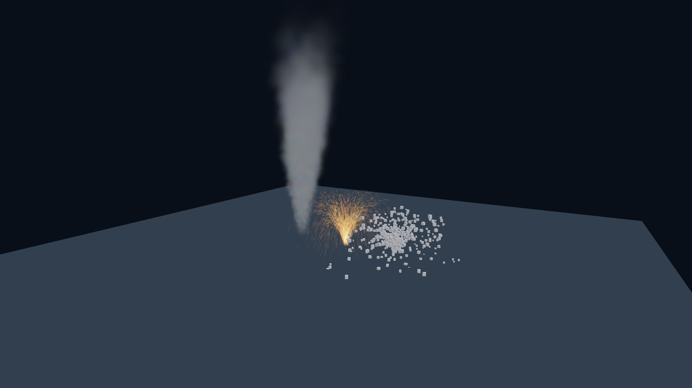

# CPU particles

Particle rendering shares the [frame origin](large_world.md) selected through
`FrameInfo.reference_position`. Billboard/mesh packing, soft depth and fog use
relative shader coordinates. Simulation positions, seeds and emitter state keep
their existing spaces; changing the reference does not move the simulation.

The optional `c3d_particle` package supplies fixed-pool CPU simulation and particle
effect materials. It publishes ordinary core [billboard batches](billboards.md)
or [mesh instances](instancing.md). Core owns rendering, culling and sorting.

Select `c3d_particle` alongside core in the consumer project, with the normal
renderer/platform dependencies needed by the application. The package itself
imports only core and the standard library.

## Create an emitter

Inside a fallible function with live `assets` and `scene`, importing
`c3d`, `c3d::particle`, `c3d::scene`, `c3d::asset` and `c3d::material`:

```c3
particle::register_particles(&scene)!;
ShaderId shader = particle::add_particle_shader(&assets)!;
MaterialId sparks = particle::add_particle_material(
    assets: &assets,
    shader: shader,
    params: { .color = { 1, 0.6f, 0.1f, 1 }, .soft_distance = 0.2f },
    blend: BlendMode.ADDITIVE,
)!;

ParticleSystemDesc desc = particle::default_particle_system_desc();
desc.capacity = 4096;
desc.material = sparks;
desc.render_mode = ParticleRenderMode.STRETCHED;
desc.shape = EmitterShape.CONE;
desc.radius = 0.1f;
desc.rate = 200;
desc.speed = { .min = 3, .max = 6 };
desc.lifetime = { .min = 1, .max = 2 };
desc.gravity_scale = 1;
desc.stretch = 0.05f;
Node* emitter = scene.add_particle_system(desc, name: "sparks")!;
emitter.local.position = { 0, 1, 0 };
scene.update_world();
```

Register once before adding systems. Registration can fault `CAPACITY_EXCEEDED`;
destroy the scene after a partial registration failure. Emitter creation itself
is atomic: it validates the descriptor, allocates one pool and creates the
emitter plus one draw child, rolling back on failure. Invalid descriptors return
`INVALID_ARGUMENT`; scene capacity failure returns `CAPACITY_EXCEEDED`.

## Pending authoring

`scene.attach_particle_system(node, desc)` validates and attaches authoring to
an existing node. It allocates no pool or draw child and leaves the system
pending. `ParticleSystem.is_prepared()` reports whether both are installed.
The shared [owner readiness table](owner_readiness.md) defines preparation and
removal behavior. Attachment starts with `emitting = true`; this flag remains
application-settable. A codec must restore its authored `emitting` value after
attachment, before preparation, instead of inheriting the attachment default.
`particle::prepare(&scene, node)` prepares one owner.
`particle::prepare_subtree(&scene, root)` attempts every pending system in a
subtree, including its root.
Omit the root or pass null to select the whole scene.

Preparation is a no-op for an already-prepared system. A failure returns
`INVALID_ARGUMENT` or `CAPACITY_EXCEEDED`, retaining pending authoring and
releasing staged pool storage. A subtree pass continues after a failure and
returns the first fault; successful owners remain prepared. Retry individual
owners or the subtree after correcting the cause.

`particle::update` skips pending systems without changing their authoring,
queued bursts or emission controls. They have no generated draw child and draw
nothing. `particle::step` requires a prepared system. The existing
`scene.add_particle_system` combines attachment and preparation and still
returns a ready emitter or removes the incomplete emitter on failure.

## Frame order and ownership

After animation/physics and any emitter edits:

```c3
scene.update_world();
particle::update(&scene, delta_seconds, wind_velocity);
```

Update steps every system, runs the [sub-emitters](#events-and-sub-emitters), then publishes the
draws, so particles spawned by events are drawn in the same update.
Render every camera afterward. Rendering does not advance the simulation.
`wind_velocity` is application-owned world-space air velocity in metres/second.
Hidden emitters continue simulating. Their WORLD/identity draw child inherits
visibility and subtree lifetime; update explicitly copies the emitter's layer
mask because layers are not inherited.

After an origin rebase, call `scene.shift_particles(offset)` after `Scene.shift_origin` and before `update_world`. It
subtracts the offset from every live particle position and every queued event position, and resets each draw child,
which is world-space and was moved by the scene shift, to the identity transform. The next `update_world` and `particle::update` publish the draws.

The descriptor is captured at creation and remains immutable. Runtime controls
are `ParticleSystem.emitting`, `emit_burst(count)`, emitter transforms and wind.
Material values use the ordinary asset revision API. Recreate a system to change
its capacity, emission configuration, render mode or asset references.

The library owns the pool arrays, counters, PRNG state and draw child. Inspect
them as short-lived component borrows; do not resize/edit the arrays or remove,
reparent or replace the owned child independently. Removing the emitter or scene
releases pool and draw storage immediately. Removing only ParticleSystem frees
the pool; the next `particle::update` removes the orphan draw child, so run that
update before rendering. Shared materials, shaders, textures and mesh geometry
remain in the asset store.

## Emission and simulation

Positions and velocities are world-space after emission. Emitter scale affects
spawn volume, while sampled speed remains in world metres/second. Subsequent
emitter motion does not carry existing particles.

- POINT uses the origin and uniform sphere directions.
- BOX samples its volume and independent sphere directions.
- SPHERE samples uniform volume and outward directions.
- CONE samples a disk at local Y=0 and a uniform solid angle about +Y.

Rate emission retains a fractional accumulator. Bursts are queued and remain
effective while `emitting` is false. A request past the free capacity follows the
[saturation policy](#saturation). Refused requests accumulate in `dropped`; the
counters saturate instead of wrapping. Refused requests do not consume PRNG
draws and never cause work proportional to their count.

Each update clamps simulated time to 0.1 seconds, expiring existing particles
before accepting emission. Accepted newborns participate in that step's
integration and leave it with age equal to the clamped duration. Newborns with
already-exhausted lifetime expire without a replacement in the same step. A
zero-duration update consumes bursts and publishes age-zero particles.

Velocity receives gravity, then drag toward wind; position uses that updated
velocity. Expiry swap-removes every stream together. Equal seeds/configuration
and identical emitter-pose, delta and wind sequences replay identically within
the same build. There is no cross-compiler/version bitwise guarantee.

The seed is encoded as four little-endian bytes for Sfc32Random. Unit samples
use the high 24 bits of its integer output. Shape draws precede lifetime, speed,
size, rotation, spin and the particle's colour seed. Equal scalar endpoints still
consume a draw. One fixed integer hash of the stored seed supplies a single
fraction for the RGBA lerp between `color_min` and `color_max`, then the result
is multiplied by the eight-sample colour table. Colour endpoints may descend
in any channel; each endpoint still requires nonnegative finite RGB and alpha
in [0,1]. Scalar and colour tables linearly interpolate normalized age/lifetime.

## Saturation

`ParticleSystemDesc.saturation` selects what a step does when the burst and rate
requests exceed the free capacity.

- `REFUSE`, the default, emits what fits. The rest is refused and counted in
  `dropped`.
- `DROP_OLDEST` evicts the oldest live particles to make room, then emits.

A step runs in this order: expire, compute the request (queued bursts plus rate
credit), evict, emit. Under `DROP_OLDEST` with `alive + request > capacity`, the
step evicts `min(alive, alive + request - capacity)` particles with the smallest
`ParticleSystem.spawn` values. Each particle takes its spawn value from the
system's `next_spawn` counter at birth, so values are unique and "oldest" has no
ties. Particles born in the step do not exist yet when eviction runs, so same-step
births are never evicted. A request larger than the capacity still emits
`capacity` particles and refuses the excess into `dropped`.

`dropped` counts requested particles that were refused for lack of room.
`evicted` counts live particles removed to make room. Both are cumulative, start
at zero, saturate instead of wrapping, and restart when a system is read from
serialized data. Neither eviction nor refusal consumes PRNG draws, so emission
draws are the same under both policies.

Eviction runs only on a saturated step and selects the victims in one pass over
the pool. The pivot is the median of three fixed slots, never random, so equal
seeds and call sequences evict the same particles and leave the same pool. The
selection reorders the pool in place; pool order carries no meaning, as expiry
already swap-removes. The `spawn` stream adds 8 bytes per particle to the pool
under either policy.

## Events and sub-emitters

A sub-emitter spawns particles in another particle system where a particle of this one is born or dies.
`ParticleSystemDesc.sub_emitters` holds up to `MAX_SUB_EMITTERS` entries, `sub_emitter_count` of them in use.
`max_events` sizes the event queue; it must be at least 1 when sub-emitters are present.
A `SubEmitter` has these fields:

| Field | Meaning |
| --- | --- |
| `trigger` | `DEATH` fires when a particle expires, is evicted or dies on impact. `BIRTH` fires when a particle is emitted. `IMPACT` fires when a particle hits a surface, see [Collision](#collision). |
| `target` | The node of the particle system that receives the children; it may be the same system. |
| `count` | Particles spawned per event. |
| `inherit_velocity` | Share of the parent particle's velocity added to each child, in [0, 1]. |
| `on_evict` | Lets `DEATH` fire for evicted particles as well. Off by default, which bounds cascades under `DROP_OLDEST`. |

### Events

A step raises `DEATH` events with cause `EXPIRED`, `EVICTED` or `IMPACT`, `BIRTH` events, and `IMPACT` events. An event is queued only if
some sub-emitter of that system accepts it, so events nobody listens for neither occupy the queue nor count as
dropped. An event records the particle's position, velocity and seed, and its index in the system's event sequence.

The queue has `max_events` entries of 48 bytes each, inside the pool allocation. An event raised into a full queue
is lost and counted in `dropped_events`. Size the queue for the most events one update can raise: the deaths and
births of one step, plus events carried over from the previous update.

### Delivery

After every system has stepped, `particle::update` processes the queues in store order, then queue order, and
delivers each event to each accepting sub-emitter in index order. A delivery spawns `count` particles in the
target, at the event position, through the target's own emission shape and descriptor. The target's world matrix
supplies the orientation and scale; its translation is replaced by the event position. A child's velocity is
its emitted velocity plus the parent's velocity times `inherit_velocity`. Children start at age zero and are first
integrated by the next update.

The children draw from a generator seeded by a hash of the parent particle's seed, the event index and the
sub-emitter index. They consume none of the target's own random stream, and equal inputs replay equal children.

A target that is not alive, is not a particle system, or is not prepared is skipped, and each skipped delivery is
counted in the source system's `skipped_events`. Update adds and removes no nodes, so targets must exist and be
prepared before the update runs; attach pending systems and call `prepare_subtree` first.

A delivery requests `count` particles from the target as a burst would, so the target's
[saturation policy](#saturation) applies. With `REFUSE`, children that do not fit are counted in the target's
`dropped`. With `DROP_OLDEST`, the target evicts its oldest particles to make room, counted in its `evicted`, and
raises `EVICTED` events for its own sub-emitters; children beyond its capacity are counted in its `dropped`.

### Recursion

Events raised while events are being delivered wait for the next update. These are `BIRTH` events of children
and `EVICTED` events in a target. A chain from A to B to A therefore advances one level per update, and the work of
one update is bounded by the queue capacities.

### Counters

| Counter | Counts |
| --- | --- |
| `dropped` | Requested particles refused for lack of room. |
| `evicted` | Live particles removed to make room. |
| `dropped_events` | Events lost to a full queue. |
| `skipped_events` | Deliveries whose target was unavailable. |
| `collision_skips` | Particles that waited out a step because the callback budget ran out. |

All five are cumulative, start at zero, saturate instead of wrapping, and restart when a system is read from
serialized data. A descriptor with more than `MAX_SUB_EMITTERS` sub-emitters, an `inherit_velocity` outside
[0, 1], or sub-emitters with `max_events` of zero fails `INVALID_ARGUMENT`.

## Collision

`ParticleSystemDesc.collision` makes a system's particles meet surfaces. The default response is `NONE`. A
`ParticleCollision` has these fields:

| Field | Meaning |
| --- | --- |
| `response` | `NONE` disables collision. `BOUNCE` reflects the particle. `STICK` stops it. `DIE` removes it. |
| `restitution` | Share of the normal speed a bounce keeps, in [0, 1]. |
| `friction` | Share of the tangent speed a bounce loses, in [0, 1]. |
| `radius_scale` | The collision radius is the drawn size, `size` times the size table, times this scale. |
| `ground_plane` | Collide with the plane `y = ground_height`, with no callback. |
| `ground_height` | Height of the plane, in world metres. |
| `max_queries` | Callback casts per step. |
| `impact_speed` | Least speed into the surface, in metres per second, that raises an `IMPACT` event. |

A step runs in this order: expire, evict, emit, integrate, collide. After integration each particle's last move is
tested as the segment from `position - velocity * dt` to `position`. A segment of zero length, as in a
zero-duration update or for a particle at rest, is not tested. Newborns are tested over their first move. Children
spawned by event delivery are tested from the next step.

### Ground plane

`ground_height` is a world height; the origin rebase moves nodes horizontally only, so it never moves the plane. The
plane needs no callback and is tested for every particle in every step.
A particle hits it when its segment ends with the centre less than one radius above the plane while moving down.
A segment that starts at or below that height hits at its start, so a particle resting on the plane cannot fall
through it by rounding, and a particle that starts under the plane and moves down is placed on it.

### Callback

`ParticleSystem.set_collision(cast, context)` installs a `ParticleCollisionFn`. The system calls it with the
segment of a particle's move in scene space and the collision radius, and it fills a `ParticleHit` and returns
true when a sphere of that radius meets a surface. `point` is the contact point on the surface, `normal` has unit
length and faces the particle, and `fraction` is the position of the hit along the segment. The package does not
import physics or any other query provider; the application adapts one.

- The cast runs on the owner thread inside `particle::update`. A physics world must not be stepping then: call
  its update before `particle::update`, as the `particles --collide` example does.
- `context` is passed unchanged to every call. It must outlive the system, or the application clears the cast
  first with `set_collision(null, null)`. A null `cast` removes it.
- The cast and context are not serialized. A system that was loaded, or prepared again, needs `set_collision`
  again. `set_collision` requires a prepared system.
- When both the plane and the cast are active, a particle takes the hit with the smaller fraction.

A physics adapter casts a ray along the segment:

```c3
fn bool cast_physics(void* context, Vec3 from, Vec3 to, float radius, ParticleHit* out) {
    PhysicsWorld* physics = context;
    Vec3 path = to - from;
    float length = path.length();
    RayHit? hit = physics.raycast(from, path / length, length);
    if (catch hit) return false;
    *out = { .point = hit.point, .normal = hit.normal, .fraction = hit.fraction };
    return true;
}

system.set_collision(&cast_physics, &physics);
```

`PhysicsWorld.cast_shape` with a sphere collider of `radius` also honours the radius, and `spatial::pick` serves
scene meshes without physics; both allocate per call, so give them a small `max_queries`.

### Budget

At most `max_queries` casts run per step. The step starts at `query_cursor`, a pool index, and visits the pool in
order, wrapping at the end. When the budget runs out, the remaining particles skip the callback that step and
are counted in `collision_skips`; the plane still applies to them. The next step starts at the first particle
that was skipped, so no particle is skipped every step, and with a steady pool each is queried at least once every
`ceil(alive / max_queries)` steps. A step that fits in the budget leaves the cursor unchanged. `max_queries = 0`
disables the callback. The pool order changes when particles die, so the cursor is a rotation, not a fixed assignment.

### Responses

A `BOUNCE` or `STICK` hit places the particle at `point + normal * radius` and drops the rest of that step's move.

- `BOUNCE` splits the velocity into a part along the normal and a part across it. The normal part is reversed and
  scaled by `restitution`; the tangent part is scaled by `1 - friction`. A hit on a particle that is moving away
  from the surface leaves its velocity alone.
- `STICK` sets the velocity to zero.
- `DIE` removes the particle. Its `DEATH` event has cause `IMPACT`, and `on_evict` does not apply to it.

A hit raises an `IMPACT` event, for `IMPACT` sub-emitters, when the speed into the surface before the response is
at least `impact_speed`. The event is at `point` and carries the velocity from before the response. The default
speed is 1 m/s, above the 0.98 m/s that gravity adds over the longest step, so a particle that sticks or settles on
a surface stops raising events once its speed into it falls below that. Zero raises an event for every hit. The response
applies to every hit, and a `DIE` hit raises its `DEATH` event whatever its speed.

A particle pressed against a surface still hits it on every step, so it spends one callback query per step.

Collision draws nothing from the system's random stream, and its results follow the cast's answers in pool order.
A descriptor with `restitution` or `friction` outside [0, 1], a negative or non-finite `radius_scale` or
`impact_speed`, a non-finite `ground_height`, or a response other than `NONE` with no plane and `max_queries` of
zero fails `INVALID_ARGUMENT`.

## Draw modes and materials

BILLBOARD uses square camera-facing quads. STRETCHED supplies core with world
velocity as direction and full dimensions `(size, size + speed * stretch)`;
core handles per-camera projection and the zero/parallel-direction fallback.
Rotation is an extra in-plane turn. MESH publishes the supplied geometry/material
with uniform scale and rotation about world +Y. Mesh particles inherit that
material's alpha/depth behaviour; they do not cast shadows or trace in this
delivery. Zero-area/zero-scale output is omitted without removing the simulated
particle. Pick indices identify compacted draw records, not stable particles.

`add_particle_shader` creates a shared fragment-only shader using core's depth
snapshot, with its [weighted form](custom_shaders.md#weighted-transparency), so source-over
particles take part in a view with `transparency = WEIGHTED`. `add_particle_material` copies a 32-byte payload and creates a blended,
depth-tested, double-sided material with depth writes off. Slot 0 is an optional
sprite map. `ParticleMaterialParams.color` multiplies particle/texture colour.

`soft_distance > 0` fades coverage over the scene-depth gap. Zero disables the
fade, retaining hardware depth testing. The shader still declares depth reads,
so setting soft distance to zero does not remove its snapshot requirement.
Empty/hidden batches make no draw or snapshot request.

`ParticleMaterialParams.lighting` selects the illumination:

- **UNLIT** keeps the input radiance.
- **AMBIENT** multiplies it by scene ambient plus core diffuse indirect
  illumination, including the environment or selected probe volume.
- **DIRECT** adds every punctual and directional light that shares a layer with
  the particle system, on top of AMBIENT. The stage walks the clustered light
  list when the frame has clusters and the flat list otherwise.
- **DIRECT_SHADOWED** is DIRECT with each light multiplied by its shadow-map and
  cloud-shadow visibility at the particle's position.

`ParticleMaterialParams.normal` selects what a lit particle presents to the
lights. DIRECT and DIRECT_SHADOWED read it; UNLIT and AMBIENT ignore it.

- **CAMERA** is the billboard's facing axis, so every pixel has the same normal.
- **SPHERICAL** bulges the normal toward the camera across the quad, as on a
  sphere inscribed in it. It is built in the quad's own frame, so the particle's
  rotation and the STRETCHED axis turn it with the quad, and the sphere's top is
  the quad's top edge.
- **VOLUME** has no surface. Each light scatters through the Henyey-Greenstein
  phase function with `ParticleMaterialParams.anisotropy`, the asymmetry
  `HeightFog.anisotropy` and `MediumVolume.anisotropy` use: positive values
  scatter forward, so the particle brightens when the camera looks toward the
  light. The angle is taken between the view ray from the camera and the
  direction to the light.

`anisotropy` applies to VOLUME only; other normals ignore it. `add_particle_material`
faults `INVALID_ARGUMENT` for a value that is not finite or lies outside (-1, 1).
The normal and the anisotropy can change at runtime with the other parameters.

Each light adds `albedo * response * radiance` to the AMBIENT term, where albedo
is the particle colour times the material colour times the map in slot 0 and
radiance is the light's colour, intensity and attenuation. The response is
`max(N.L, 0) / pi` for CAMERA and SPHERICAL, the Lambert convention core
materials use. For VOLUME it is the phase function, which integrates to one over
the sphere: at zero anisotropy it is `1 / (4 pi)`, a quarter of Lambert's
response at normal incidence, so a light meant to read on smoke needs a
correspondingly higher intensity. The AMBIENT term always uses the camera axis.

DIRECT_SHADOWED reads the shadow atlas and the cloud shadows only. The stage is
compiled without ray-traced shadows, so a light whose only shadow is ray traced
contributes unshadowed, in views that trace shadows too. Particles cast no
shadow, and the stage ignores the receive-shadow flag, which billboard draws never
carry: the lighting mode is the opt-in.

DIRECT adds one light loop per covered pixel, and DIRECT_SHADOWED adds a shadow
lookup per shadow-casting light in that loop. The cost therefore grows with the
pixels a system covers and with the lights that reach them, which is why the
modes are opt-in.

Fog uses `apply_material_fog` on the lit colour before coverage is premultiplied
exactly once. ADDITIVE adds the lit, coverage-scaled RGB and preserves
destination alpha. The ordinary and the weighted-transparency forms light alike.

Simulation is inline, with no allocation during normal step/update. The pool is
one aligned allocation of nine capacity-sized streams and the event queue; core
separately owns draw arrays and persistent GPU records. GPU simulation, particle-particle collision,
ribbons and parallel execution are outside this delivery. Core
billboard material restrictions are documented separately.

## Flipbooks

`ParticleSystemDesc.flipbook` plays a sprite sheet on BILLBOARD and STRETCHED particles. It is off while `columns`
is 0. The system copies the layout to its draw child's [sprite sheet](billboards.md#sprite-sheets) when it is
prepared, so frames run row-major from the top-left cell of the image as stored. A `ParticleFlipbook` has these fields:

| Field | Meaning |
| --- | --- |
| `columns`, `rows` | Grid of the sheet; 0 columns disables the flipbook. |
| `frame_count` | Frames played, 1 to `columns` x `rows`. |
| `inset` | UV units cut from each cell edge; half a texel of the sheet texture. |
| `mode` | `OVER_LIFE` spreads the frames over a particle's lifetime. `FPS` plays them at `fps` frames per second of age. |
| `fps` | Frames per second of age in `FPS` mode; finite and above 0. |
| `random_start` | Each particle starts on a frame chosen from its seed. |
| `blend` | Writes fractional frames that blend toward the next frame. Off writes whole frames. |

Each update writes `Billboard.frame` for every published particle. Let t be age divided by lifetime, clamped to
[0, 1], and s the start frame: 0, or with `random_start` the frame chosen below. Let n be `frame_count`.

| Mode | Frame |
| --- | --- |
| `OVER_LIFE`, `blend` | s + t x (n - 1) |
| `OVER_LIFE`, whole frames | s + min(floor(t x n), n - 1) |
| `FPS` | s + age x `fps`, floored when whole frames are written |

The value is written modulo n, so floats stay small. A fractional frame blends toward the next one, and the last
frame blends toward frame 0. Under `OVER_LIFE` a particle with a start frame plays n - 1 frames on from it, wrapping
past the last frame.

The start frame is the fraction of a second hash of the particle's seed, times n, rounded down. It takes no draw from
the system's random stream, so equal seeds emit equal particles with or without a flipbook.

`add_particle_shader` samples slot 0 at the current cell through UV0. On a draw with a sprite sheet it also samples the
next cell through UV1 and mixes the two by `v_billboard.z`, the fraction of `frame`, whichever UV set the slot names.
A draw without a sprite sheet samples once. A flipbook draw therefore takes two texture samples per fragment, also
for whole frames. Other fragment stages read the sheet as described in [billboards](billboards.md#sprite-sheets).

`add_particle_system` and `attach_particle_system` fault `INVALID_ARGUMENT` for a flipbook in MESH mode, a layout that
breaks the [billboard sprite-sheet rules](billboards.md#sprite-sheets) (`frame_count` outside 1 to `columns` x `rows`,
`rows` of 0, an `inset` that is negative, not finite or at least half a cell), and an `fps` that is not finite or not
above 0 in `FPS` mode. A disabled flipbook reads only its `inset`.

Neighbouring cells meet at a texel boundary, so filtering can mix their colours. The
[edge rules](billboards.md#edges-and-mipmaps) apply: set `inset` to half a texel of the sheet, pad each cell of a
mipmapped sheet with 2^(m-1) texels for m sampled levels, and expect no guarantee under anisotropic filtering.

## Example and measurements

```powershell
python scripts/build.py --example particles
python scripts/build.py --target particles --opt O3
addons/c3d_particle.c3l/build/particles.exe --benchmark --frames 300
addons/c3d_particle.c3l/build/particles.exe --stress --frames 300
```

Linux uses `build/particles` without `.exe`. The window shows smoke, additive
stretched sparks and mesh debris, with emitting/burst controls, wind, smoke
lighting/soft distance, spark blending and a second camera. Validation is always
enabled. `--frames N` closes an interactive smoke test after N frames.

`--sparks` adds a smoke system that each dying spark feeds through a `DEATH`
sub-emitter, and shows its live count with the event counters. It applies to the
window and to `--benchmark`, which also prints them.

`--smoke` plays a generated 4x4 sprite sheet on the smoke system, in `FPS` mode with `random_start` and `blend`.
Each 64-texel cell holds one puff inside an 8-texel border at zero alpha, and the batch `inset` is half a texel, so the
sheet follows the edge rules for four sampled mip levels. It applies to the window and to `--benchmark`, which can
save the image with `--capture-rgba`. The inspector's smoke controls drive both smoke materials. The flag does not
combine with `--stress`.

`--collide` makes the sparks bounce on the ground plane and, through a physics
ray cast, on a canopy and two crates that are static physics bodies. It applies
to the window and to `--benchmark`, and `--benchmark` prints `collision_skips`.
The `particles` target selects `c3d_physics` for this; the particle package never imports physics.

The example reads `Renderer.adapter_name`, borrowed until renderer destruction,
and calls `renderer.log.check_validation()` through core. The latter reports a
backend validation error retained in the recent diagnostic ring; overwritten
entries are no longer checked. Neither operation requires importing gpu.c3l.

`--stress` runs only CPU work: one seeded system with 100,000 stretched
billboards, emitted before timing, 60 warm-up updates and the requested number
of measured updates. It reports simulation/publication, uncached
`billboard_world_bounds` and `pack_billboard_records` separately. Every update
advances the batch revision, so the bounds measurement rebuilds it. Packing
writes a preallocated CPU array; upload and GPU execution are excluded. The
printed checksum consumes bounds and packed output. `--stress` and
`--benchmark` are separate modes.

`--stress` prints two segments. `stress` is the full pool with no emission;
`saturated` is the same pool with a rate that requests a tenth of the capacity
every step. Each segment reports `refused` (the system's `dropped`) and `evicted`.
`--drop-oldest` selects `DROP_OLDEST` for both segments; the default is `REFUSE`.
Only the `saturated` segment differs between the two policies.

The headless benchmark uses one 1920x1080 display-output view without AA, 60
rendered warm-up frames and 300 measured frames per segment. Active simulation
is prewarmed for twenty simulated seconds. It reports actual live counts and
matches delayed GPU results to the measured frame range. `--capture-rgba path`
saves the last display-encoded RGBA8 image for inspection.

Baseline measured before the palette interpolation correction on September 30,
2026: Windows x64, NVIDIA GeForce RTX 4090, C3 0.8.3
`-O3`, Vulkan validation on, GPU+INTERNAL profiling, inline simulation. Means over
300 frames; GPU measurements also contain 300 matched samples.

| Metric | Empty systems | Active systems |
| --- | ---: | ---: |
| Particle update CPU | 0.000326 ms | 0.108573 ms |
| Whole frame CPU | 1.035607 ms | 1.436521 ms |
| Instance sort GPU | Not recorded | 0.055815 ms |
| Transparent pass GPU | Not recorded | 0.185436 ms |
| Live smoke, mean / capacity | 0 / 8192 | 8169.7 / 8192 |
| Live sparks, mean / capacity | 0 / 4096 | 4083.2 / 4096 |
| Live debris, mean / capacity | 0 / 1024 | 1020.9 / 1024 |

These are this scene's measurements, not a general performance guarantee. The
measured CPU update is below the 1 ms executor follow-up threshold; parallel
execution was not implemented or measured.

The 100,000-particle CPU stress baseline at `0e9cd0d` on an Intel Core i9-14900K, Windows x64,
C3 0.8.3 `-O3`, produced the following medians of three runs. Each run measured
300 updates after 60 warm-up updates, with 100,000 live and published particles
throughout. Emission and allocation occur before timing.

| CPU operation | Median | Range of run means |
| --- | ---: | ---: |
| Simulation and draw publication | 0.776409 ms | 0.767330–0.780976 ms |
| Uncached billboard bounds | 0.267105 ms | 0.264326–0.272588 ms |
| Billboard record packing | 0.600191 ms | 0.592434–0.604158 ms |

Bounds and packing together cost about 0.867 ms in this stress case. Both
convert every record to world space after a revision change; unchanged bounds
are cached. This records the cost of that shared conversion without adding a
second representation or an executor. It excludes emission, upload, sorting
and rendering, and does not replace the default-scene measurement above.

Windows acceptance passed all 17 particle CPU tests and six Vulkan cases, with
validation. Native Linux compilation and the earlier 16 CPU tests passed in WSL
before the palette regression test was added.
WSL verification is limited to builds and CPU tests. GPU acceptance runs on
Windows.



## Serialization

Select `c3d_serial` and enable `C3D_PARTICLE_SERIAL` to register particle authoring codecs. Reads create pending systems; prepare them before ordinary updates. The description is version 5. Version 2 added `saturation`, version 3 added `sub_emitters`, `sub_emitter_count` and `max_events`, version 4 added `collision`, and version 5 adds `flipbook`; older payloads in both encodings read the defaults, which is no collision and no flipbook. The collision callback is not serialized. A sub-emitter target is an entity reference and must lie inside the exported subtree. See [the serialization contract](../addons/c3d_particle.c3l/src/serial/README.md) for ownership, restart behavior and the feature-on test targets.
