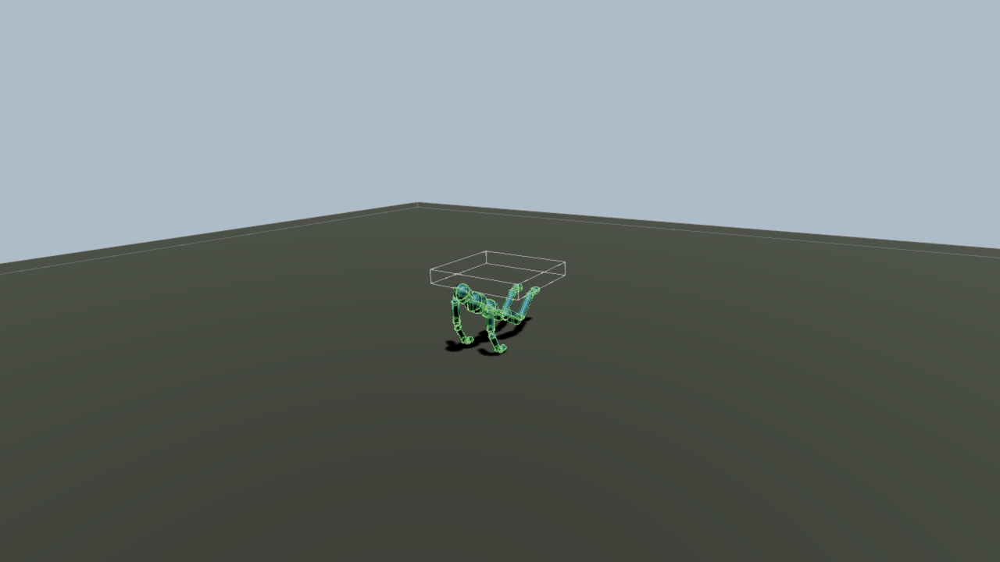
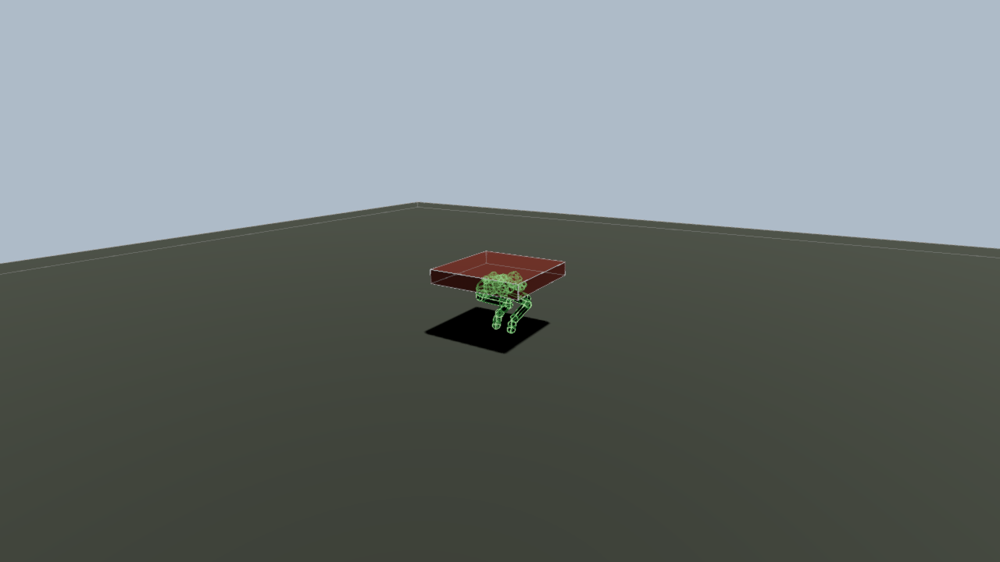
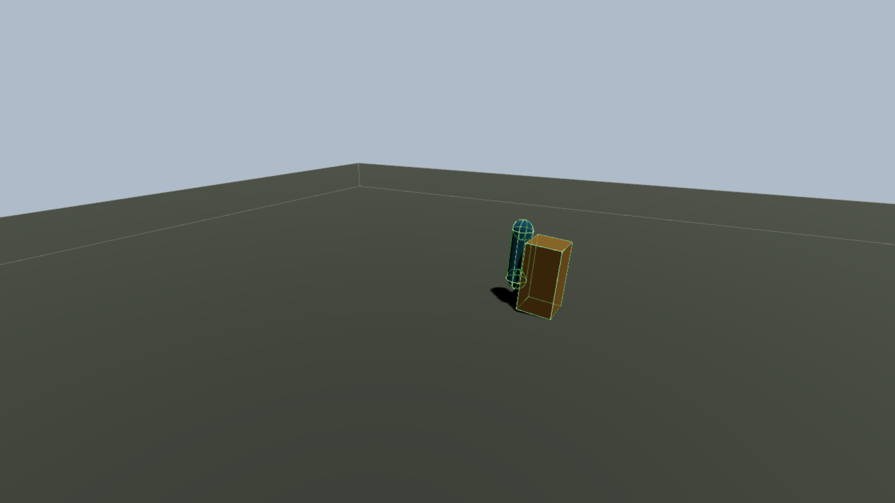

# Ragdolls

A `Ragdoll` component on a skinned node gives each chosen bone a capsule body and a joint to its parent bone. Bones
switch between `ANIMATED` (a kinematic body that follows the animation) and `SIMULATED` (a dynamic body that falls,
collides and is pulled toward the animated pose by a spring). A weight blends the simulated pose into the skeleton,
and physical recovery brings simulated bones back to an animation without a visible snap. The component and its calls
are in `c3d::physics`, in the [physics add-on](physics.md); there is no feature flag.

## Quick start

The node carries a `SkinBinding` and has a world matrix with unit scale. Inside a fallible function, with the
physics world and `register_physics` in place:

```c3
RagdollBone[2] bones;
bones[0] = physics::default_ragdoll_bone(skeleton.find_joint("DEF-hips")!);
bones[0].radius = 0.12f;
bones[1] = physics::default_ragdoll_bone(skeleton.find_joint("DEF-spine.001")!);
bones[1].radius = 0.12f;
bones[1].length = 0.2f;
bones[1].cone = { .enabled = true, .upper = 0.4f };
bones[1].twist = { .enabled = true, .lower = -0.3f, .upper = 0.3f };
bones[1].drive = { .enabled = true, .hertz = 6, .damping_ratio = 1 };

RagdollDesc desc = physics::default_ragdoll_desc();
desc.bones = bones[..];
scene.build_ragdoll(&assets, skin_node, desc)!;

world.set_ragdoll_mode(skin_node, SIMULATED);
scene.get(skin_node, Ragdoll).weight = 1;
```

`skeleton` is the skin's `Skeleton`. The `ragdoll` example and `examples/ragdoll_bones.c3` build a twelve-bone rig
for the humanoid in `examples/assets/quaternius`; run the example with `python3 scripts/build.py --example ragdoll`.

## Concepts

- **Bones.** `RagdollDesc.bones` lists `RagdollBone` records, parents before children; the first is the root (the hips).
  A bone names a skeleton joint and runs from that joint to its child bone's joint, or for `length` metres. Its parent
  bone is the bone of the nearest ancestor joint that has one. `build_ragdoll` creates one child node of the
  skin node per bone, with a kinematic capsule `PhysicsBody` and, for a bone that has a parent bone, a
  `PhysicsJoint` to it. Joints that have no bone take the mode and weight of the nearest bone above them.
- **Joint kinds.** A bone's `kind` is `SPHERICAL` (cone and twist limits) or `REVOLUTE` (`hinge_axis` in the joint's
  bind-pose space, `angle` limit). `drive` is the spring that pulls a simulated bone toward the animated pose; its
  `hertz` is multiplied by `Ragdoll.drive_strength` (0 at build, so the drive is off until raised).
- **Modes.** Every bone is `ANIMATED` at build. `set_ragdoll_mode` switches all bones, `set_bone_mode` one bone, in
  place and keeping velocity. Bones may mix modes; a kinematic parent of a dynamic bone acts as infinite mass.
- **Weights.** `Ragdoll.weight` (0 is the animated pose, 1 the ragdoll pose) times `bone_weights[bone]` (1 at build)
  blends each joint toward its simulated pose when `update_ragdolls` publishes. Authored weights are finite and
  nonnegative; values above 1 are accepted.
- **Ownership.** The skin's joint nodes belong to the animation. The bone nodes are the ragdoll's. Remove a ragdoll with
  `Scene.remove_ragdoll(skin_node)`, which removes the bone nodes and the component.

`RagdollBone` fields:

| Field | Default | Meaning |
| --- | --- | --- |
| `joint` | required | Skeleton joint index. Each joint carries at most one bone. |
| `radius` | 0 | Capsule radius in metres. Set it. |
| `density` | 1000 | kg/m³. |
| `length` | 0 | Bone length. 0 measures to the child joint; a leaf bone with no child needs a value. |
| `kind` | `SPHERICAL` | `SPHERICAL` or `REVOLUTE`. |
| `hinge_axis` | none | `REVOLUTE`: axis in the joint's bind-pose space; must be nonzero. |
| `cone`, `twist` | disabled | `SPHERICAL` limits; `cone.upper` is the half angle in radians. |
| `angle` | disabled | `REVOLUTE` limit in radians. |
| `drive` | disabled | `JointSpring` toward the animated pose; there is no torque cap, so stiff drives on light bones jitter. |

`RagdollDesc.filter` is the `CollisionFilter` of every bone shape (default `FILTER_ALL`); `collide_adjacent` lets
neighbouring bones collide (default false). `build_ragdoll` faults `NO_SKIN`, `RAGDOLL_EXISTS`,
`c3d::INVALID_ARGUMENT` (no bones, a bad joint index, a duplicate joint, a child listed before its parent bone, a
missing leaf `length` or a zero hinge axis), `c3d::UNSUPPORTED` (a scaled skin node) and `c3d::CAPACITY_EXCEEDED`.

## Frame order

```c3
anim::update(&assets, &scene, delta);
scene.update_world();
world.update(delta);
world.update_ragdolls();
scene.update_world();
```

At the start of `PhysicsWorld.update`, kinematic bones take their pose from the animated joints and simulated bones
receive their drive targets. `update_ragdolls` writes the blend into the skin's joint locals, so call it after `update`
and refresh the scene afterwards. Cloth, IK and debug consumers read the result.

## Physical recovery

Recovery returns simulated bones to a freshly animated pose without a snap. Each outer update captures the fresh
animation and the bone weights; each fixed step then tracks that pose with a capped force at the bone's centre of mass
(with gravity compensation) and a capped shortest-arc angular spring torque. Joint limits and contacts stay active, so
an obstruction slows or blocks recovery without disabling the simulation.

```c3
RagdollFacing facing = world.recover_ragdoll(skin_node, character_node)!;

// each frame, while the application lowers Ragdoll.weight toward 0 as the animation takes over
anim::update(&assets, &scene, delta);
scene.update_world();
world.update(delta);
if (scene.get(skin_node, Ragdoll).weight == 0) {
    if (catch excuse = world.finish_ragdoll_recovery(skin_node)) {
        if (excuse != physics::RECOVERY_NOT_READY) return excuse~;
    }
}
world.update_ragdolls();
scene.update_world();
```

| Call | Effect |
| --- | --- |
| `recover_ragdoll(skin_node, character, settings)` | Starts recovery of every `SIMULATED` bone. Returns the physical `RagdollFacing` (`FACE_UP` or `FACE_DOWN`) so the application can pick a get-up clip, and moves `character` horizontally to the physical hips. |
| `recover_bones(skin_node, settings)` | Starts recovery of the currently `SIMULATED` bones and leaves the character placement unchanged. |
| `finish_ragdoll_recovery(skin_node)` | Completes a settled recovery. Faults `RECOVERY_NOT_READY` (recovery stays active) or `NO_RECOVERY` (no participants). |
| `Ragdoll.recovery_status()` | `RagdollRecoveryStatus`: phase, participant count, mapped-joint position and angle errors, absolute body speeds, applied force and torque, and a captured-input fault. |
| `update_ragdolls()` | Publishes recovery and the ordinary blend. Repeating it in one frame is harmless. |

Call `recover_ragdoll` or `recover_bones` before sampling fresh animation, while the preceding frame's final joint
worlds are untouched. Entry validates every selected body and joint before changing anything. Faults:

| Fault | Cause |
| --- | --- |
| `NO_BODY` | A selected bone has no built body. |
| `NO_JOINT` | A selected bone has no bound joint. |
| `RECOVERY_POSE_MISMATCH` | A mapped joint and its native pose disagree beyond the entry limits. |
| `c3d::INVALID_ARGUMENT` | Invalid settings, weights or transforms; no `SIMULATED` bone; a simulated bone whose body is not dynamic; or `recover_ragdoll` with a non-simulated root. |

Participants stay `SIMULATED` and dynamic. Completion needs this update's captured effective weights to be zero and the
pose and velocity limits below to hold; zero global weight alone does not finish recovery. On success the bones become
`ANIMATED` with no transform snap. The native poses stay published through that update and animation resumes on the
next one.

`RagdollRecoverySettings` (`default_ragdoll_recovery_settings()` fills the defaults) must be finite; frequencies and
caps must be positive, damping and tolerances nonnegative. Arbitrary settings and rigs carry no stability guarantee.

| Setting | Default |
| --- | --- |
| `position_hertz`, `angular_hertz` | 4 Hz |
| `damping_ratio` | 1 |
| `max_force`, `max_torque` (per body) | 200 N, 20 N m |
| `entry_position_tolerance`, `entry_angle_tolerance` | 0.01 m, 0.01 rad |
| `tracking_position_tolerance`, `tracking_angle_tolerance` | 0.15 m, 0.3 rad |
| `finish_position_tolerance`, `finish_angle_tolerance` (mapped joints) | 0.015 m, 0.02 rad |
| `finish_linear_speed`, `finish_angular_speed` (absolute) | 0.03 m/s, 0.05 rad/s |

`RagdollRecoveryPhase` is `INACTIVE`, `TRACKING`, `BLOCKED`, `READY` or `COMPLETING`. `BLOCKED` reports tracking outside
the tracking tolerances or invalid captured input; it never disables contacts or forces completion.

During recovery:

- The legacy animation springs of participating bones are masked and their limits and authored values kept. Ending
  recovery restores the current authored spring settings. `drive_strength` does not scale the recovery actuator.
- Participating bone nodes publish their native poses, and mapped joints apply the bone-to-joint mapping to those same
  poses. There is no interpolation and no second visible blend. Updates without a fixed step hold the native pose.
  Unmapped children keep captured local targets. Later IK on a participant ends the equality of node and body pose.
- `set_bone_mode` (even to the current mode) cancels that bone's recovery and `set_ragdoll_mode` cancels all of it.
  `teleport` cancels the addressed bone before moving it. Replacing or removing a body and destroying the world cancel
  affected recovery. Origin shifts translate the targets.

| Prone get-up | Blocked recovery |
| --- | --- |
|  |  |
| The same dynamic capsules follow the get-up target. | An obstruction prevents completion without disabling simulation. |



The `ragdoll` example exposes obstruction, a movable neighbour and the recovery status; the [physics
inspector](physics_inspector.md) shows the same status for any ragdoll.

## Serialization

With `C3D_PHYSICS_SERIAL` a `Ragdoll` saves its authoring: bone mappings, modes, weights, drives and node placements.
Recovery state, captured sources and native identities are transient, so a restored ragdoll starts with no recovery
and zero bone velocities. See [serialization](serialization.md#ragdoll-adapter).

## Limits

- The skin node needs unit scale.
- A bone drive has no torque cap.
- For an `ANIMATED` bone, `weight` blends the live animation toward the pose captured when the ragdoll was built or
  when the last recovery began; 1 shows the captured pose.
- Recovery gains and caps do not guarantee convergence for every rig or time step.

## See also

- [Animation](animation.md) for skinning, blending and root motion
- [Physics](physics.md), [physics inspector](physics_inspector.md)
- [Cloth](cloth.md) for cloth on a ragdoll's bones
